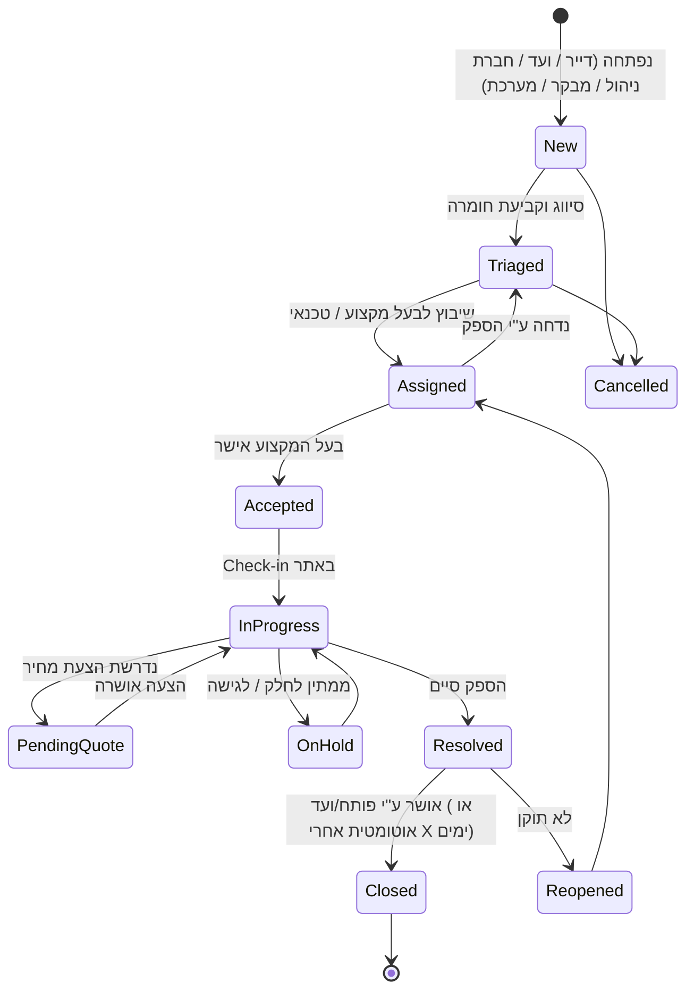

# 2. מודל תקלות, חומרה (Severity) ו-SLA

## 2.1 מחזור חיים של תקלה

## 2.2 רמות חומרה וזמני SLA (ברירת מחדל — ניתן לשינוי לכל Tenant)

| רמה | שם | דוגמאות | זמן תגובה | זמן תיקון מקסימלי | Escalation |
|-----|----|---------|-----------|-------------------|-----------|
| **S1** | קריטי / חירום | אדם תקוע במעלית, דליפת גז, הצפה, שריפה/תקלה במערכת כיבוי, הפסקת חשמל כללית, סכנה מבנית | 15 דק' | 4 שעות | מיידי: ועד + מנהל + SMS לספק כונן |
| **S2** | גבוה | מעלית מושבתת (ללא לכודים), אין מים בבניין, דלת כניסה ראשית לא ננעלת, משאבת ביוב, אינטרקום ראשי | שעה | 24 שעות | בחריגה של 50% מהזמן |
| **S3** | בינוני | תאורה בחדר מדרגות, דלת חניון, נזילה קלה ברכוש משותף, מזגן בלובי | 4 שעות | 72 שעות | בחריגה |
| **S4** | נמוך | צבע, ניקיון חריג, גינון, שלט, תיקון קוסמטי | יום עסקים | 14 יום | דוח שבועי |
| **S5** | מתוכנן | שיפור/שדרוג, בקשה כללית | — | לפי תכנון | — |

### כללים
- **קטגוריה → חומרה ברירת מחדל**: כל קטגוריית תקלה (מעלית, אינסטלציה, חשמל, כיבוי אש, ניקיון...) ותת-קטגוריה ממופה לחומרה. הדייר בוחר קטגוריה, המערכת קובעת חומרה.
- **שינוי חומרה** רק ע"י ועד/מנהל, עם נימוק שנשמר ב-Audit.
- **לוח שעות**: SLA ל-S1/S2 נמדד 24/7; S3–S4 לפי שעות עסקים מוגדרות ולוח חגים ישראלי (ניתן להגדרה).
- **השהיית שעון**: בסטטוס `OnHold` / `PendingQuote` מסוג "ממתין ללקוח" — השעון מושהה (לפי הגדרה).
- **SLA של ספק** יכול להיות שונה מ-SLA למבנה (מוגדר בחוזה השירות), והמערכת מודדת את שניהם.
- **Escalation Matrix**: מוגדרת לכל Tenant — מי מקבל התראה ובאיזה ערוץ בכל שלב (50%, 80%, 100%, 150% מהזמן).
- **תקלות חוזרות**: אותה קטגוריה + אותו נכס/מיקום תוך 30 יום → סימון "תקלה חוזרת" ודיווח לוועד.
- **מניעת כפילויות**: הצעה לדייר להצטרף לתקלה קיימת דומה (למשל "מעלית B מושבתת" כבר דווחה).

## 2.3 מדדים (KPIs)

- זמן תגובה ממוצע / חציוני (MTTA) לפי חומרה.
- זמן תיקון ממוצע (MTTR) לפי חומרה, קטגוריה, ספק.
- אחוז עמידה ב-SLA.
- מספר תקלות פתוחות לפי גיל (0–3, 4–7, 8–30, 30+ ימים).
- תקלות חוזרות, שיעור פתיחה מחדש (Reopen rate).
- עלות ממוצעת לתקלה לפי קטגוריה.
- ציון שביעות רצון ממוצע.

## 2.4 מקורות פתיחת תקלה

| מקור | הערות |
|------|-------|
| דייר / נציג חברה | דרך האפליקציה, קישור QR בלובי, WhatsApp bot [P3] |
| ועד בית | כולל פתיחה בשם דייר |
| חברת ניהול | מוקד / אב בית בסיור |
| מבקר בטיחות | אוטומטית מממצא ביקורת |
| מערכת | טיפול מונע שהגיע מועדו, אישור שפג תוקפו, [P3] חיישני IoT (מעלית, משאבה, הצפה) |
| בעל מקצוע | ממצא נוסף שגילה במהלך טיפול |
