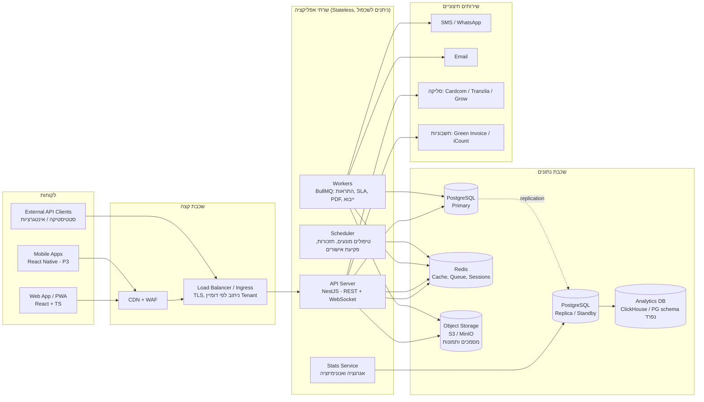

# 3. ארכיטקטורה טכנית

## 3.1 תמונה כללית



## 3.2 בחירת טכנולוגיות (המלצה)

| שכבה | טכנולוגיה | נימוק |
|------|-----------|-------|
| Frontend | **React 19 + TypeScript + Vite**, React Router, TanStack Query, Tailwind + רכיבי UI עם תמיכת RTL (shadcn/ui או MUI) | אקו-סיסטם גדול, תמיכה טובה ב-RTL, קל לגייס מפתחים |
| i18n | i18next + ICU | עברית/אנגלית/ערבית, ריבוי צורות |
| PWA | Workbox (Service Worker) | Offline למבקר ולספק בשטח, Web Push |
| גרפים | Recharts / ECharts | דשבורדים |
| Backend | **Node.js 22 + NestJS + TypeScript** | שפה אחת לכל הצוות, מודולריות, DI, Swagger מובנה |
| ORM | Prisma או Drizzle | מיגרציות, Type-safety |
| DB | **PostgreSQL 16** עם Row-Level Security | אמינות, JSONB לשדות גמישים, RLS לבידוד Tenants |
| תורים | Redis + BullMQ | משימות רקע, Retry, תזמון |
| קבצים | S3-compatible (AWS S3 / Cloudflare R2 / MinIO בהתקנה עצמית) | אותו API בענן ובשרת פרטי |
| PDF | Playwright/Chromium (HTML→PDF) | דוחות ממותגים ב-RTL |
| חיפוש | PostgreSQL Full-Text (MVP) → OpenSearch (P3) | |
| Auth | מודול Auth פנימי (OTP + סיסמה + 2FA) עם תמיכה ב-OIDC/SAML ל-SSO של חברות גדולות; אלטרנטיבה: Keycloak | |
| Observability | OpenTelemetry → Grafana / Prometheus / Loki, Sentry לשגיאות | |
| Infra | Docker, Kubernetes (k3s לשרתים קטנים), Helm, Terraform | אותו פריסה בענן ו-On-Prem |
| CI/CD | GitHub Actions | בדיקות, Build, Deploy |

> חלופה ל-Backend: Python + FastAPI (אם הצוות חזק יותר ב-Python, ובפרט לשירות הסטטיסטיקה).

## 3.3 מבנה מודולרי (Modular Monolith)

מתחילים כ-**Modular Monolith** — שרת אחד עם גבולות מודולים ברורים — ופורקים לשירותים נפרדים רק כשיש צורך (סקייל או צוותים נפרדים). זה מקטין מורכבות תפעולית בשלבים הראשונים.

```
apps/
  web/                 # React PWA
  api/                 # NestJS
    src/modules/
      tenancy/         # Tenants, branding, feature flags, settings
      identity/        # Users, auth, OTP, SSO, roles, permissions
      property/        # Buildings, entrances, floors, units, assets, common areas
      people/          # Residents, occupancy, ownership, contacts, privacy prefs
      finance/         # Charges, payments, receipts, budgets, expenses
      tickets/         # Tickets, categories, SLA engine, escalation
      workorders/      # Work orders, quotes, check-in, vendor execution
      vendors/         # Vendor profiles, licenses, insurance, contracts, ratings
      maintenance/     # Preventive plans, schedules, recurring tasks
      inspections/     # Audit templates, inspections, findings, safety score
      documents/       # Document store, versions, expiry, permissions
      comms/           # Announcements, notifications, templates, surveys, votes
      bookings/        # Facilities, visitors (P2)
      reports/         # Dashboards, exports, PDF generation
      stats/           # Anonymized aggregate datasets, external API
      audit/           # Audit log
  worker/              # Background jobs (shares modules with api)
packages/
  shared/              # Types, validation schemas (zod), enums
  ui/                  # Design system components
infra/
  docker/  helm/  terraform/  backup/
docs/
```

## 3.4 מודל רב-לקוחיות (Multi-Tenancy)

**היררכיה:**
```
Platform (אתה — מפעיל המערכת)
 └── Organization / Tenant  (חברת ניהול  או  ועד בית עצמאי)
      └── Building / Site
           └── Entrance / Floor
                └── Unit (דירה / משרד)
```

- **ברירת מחדל — Shared DB, Shared Schema + `tenant_id` בכל טבלה + PostgreSQL RLS**: זול ופשוט לתפעול, מתאים לאלפי ועדים קטנים.
- **לקוחות גדולים / רגישים — Dedicated DB או Dedicated Deployment**: אותו קוד, מסד נתונים נפרד או אשכול נפרד (ראה [מסמך 5](05-deployment-backup.md)).
- **Tenant Resolution**: לפי דומיין/תת-דומיין (`acme.ma3000.co.il`, `portal.acme-mgmt.co.il`) או לפי Header/Token.
- **גישה חוצת-Tenants**: בעלי מקצוע ומבקרים הם ישויות ברמת הפלטפורמה ומקבלים גישה למבנים ספציפיים דרך **Grants** מוגבלים (היקף + זמן).
- **Tenant Router**: שירות קטן שממפה Tenant → אשכול/DB (לתמיכה בפריסה מבוזרת).

## 3.5 מנוע SLA ותזמון

- כל שינוי סטטוס/חומרה מחשב `response_due_at` ו-`resolve_due_at` לפי מדיניות ה-Tenant, לוח עסקים וחגים.
- Job מחזורי (כל דקה) מאתר תקלות שחצו ספי Escalation ושולח התראות (אידמפוטנטי).
- Scheduler יוצר הזמנות עבודה מתכניות אחזקה מונעת (RRULE — חוקי חזרתיות כמו "כל 3 חודשים").
- Job יומי לבדיקת פקיעת אישורים, רישיונות ספקים ופוליסות.

## 3.6 זרימת אירועים

כל פעולה משמעותית מפרסמת **Domain Event** (למשל `ticket.created`, `payment.received`, `inspection.finding.created`) לתור פנימי. צרכנים: התראות, Audit, עדכון סטטיסטיקות, Webhooks ללקוחות חיצוניים. בהמשך ניתן להחליף ל-NATS/Kafka ללא שינוי בלוגיקה העסקית (Outbox Pattern).
