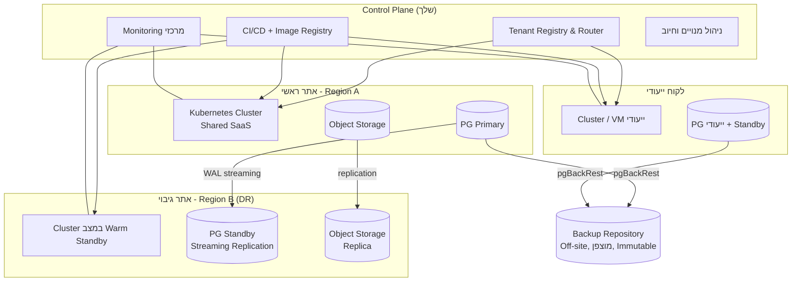

# 5. פריסה, שרתים, גיבוי והתאוששות מאסון

## 5.1 מודלי פריסה

אותו קוד ואותם Container Images תומכים בשלושה מודלים:

| מודל | למי | תיאור |
|------|-----|-------|
| **A. SaaS משותף** | ועדי בית, חברות ניהול קטנות-בינוניות | אשכול מרכזי שלך, DB משותף עם RLS |
| **B. Dedicated Cluster / DB** | חברות ניהול גדולות, מגדלי משרדים | מסד נתונים ו/או אשכול ייעודי באותו ענן; ניהול מרכזי שלך |
| **C. On-Premise / ענן הלקוח** | לקוחות עם דרישות רגולציה / ריבונות מידע | התקנה מלאה בשרתי הלקוח (Helm / Docker Compose), עדכונים מנוהלים |

## 5.2 תשתית מומלצת

**שלב 1 (MVP, עד כ-500 מבנים):**
- 2–3 שרתי VM (למשל Hetzner / AWS / Azure Israel Central / Google me-west1 בת"א) עם k3s או Docker Compose.
- PostgreSQL מנוהל (RDS / Cloud SQL / Azure Flexible) **או** PG עצמאי עם Patroni.
- Object Storage מנוהל.
- שרת גיבוי / Region שני לגיבויים.

**שלב 2 (צמיחה):**
- Kubernetes מנוהל (EKS / GKE / AKS), Autoscaling ל-API ול-Workers.
- Read Replicas לדוחות וסטטיסטיקה.
- Region DR חם (Warm Standby).

> **ריבונות מידע**: מומלץ לאחסן בישראל (אזורי הענן בישראל של AWS / Google / Azure / Oracle) — יתרון שיווקי ומקל עמידה בדרישות לקוחות מוסדיים.

## 5.3 מדיניות גיבוי

| רכיב | שיטה | תדירות | שמירה |
|------|------|--------|-------|
| PostgreSQL | pgBackRest / Barman — Full + Incremental + WAL archiving רציף (PITR) | Full שבועי, Incr יומי, WAL רציף | 35 יום PITR, חודשי ל-12 חודשים, שנתי ל-7 שנים (מסמכים פיננסיים) |
| Object Storage | Versioning + Cross-Region Replication + Object Lock (Immutable) | רציף | 90 יום לגרסאות שנמחקו |
| TimescaleDB (חיישנים) | גיבוי כמו PostgreSQL, עם דחיסה ומדיניות שמירה לפי רזולוציה | יומי + WAL | גולמי 90 יום, לפי שעה שנתיים, לפי יום 7 שנים |
| Edge Gateway | חיץ נתונים מקומי לזמן ניתוק, והגדרות שנשמרות בענן לשחזור מיידי של Gateway חלופי | רציף | לפי נפח הדיסק |
| Redis | לא מקור אמת — RDB snapshot לנוחות בלבד | יומי | 7 ימים |
| קונפיגורציה / Secrets | Git (IaC) + Vault/SOPS מוצפן | בכל שינוי | ללא הגבלה |
| לקוחות On-Prem | אותו סקריפט גיבוי + העתק מוצפן לשרת הגיבוי שלך (אופציונלי בהסכמה) | יומי | לפי הסכם |

- כל הגיבויים **מוצפנים** (AES-256) ומפתחות נשמרים בנפרד (KMS).
- עיקרון **3-2-1**: 3 עותקים, 2 סוגי מדיה/ספקים, 1 מחוץ לאתר; עותק Immutable נגד כופרה.
- **בדיקת שחזור אוטומטית** שבועית לסביבת Staging + תרגיל DR מלא רבעוני.
- **שחזור ברמת Tenant**: כלי ייצוא/ייבוא לוגי של Tenant בודד (לשחזור נקודתי ללא פגיעה באחרים, וגם לניוד ללקוח ייעודי).

## 5.4 יעדי זמינות והתאוששות

| מדד | SaaS משותף | Dedicated (Premium) |
|-----|-----------|---------------------|
| זמינות (SLA) | 99.9% | 99.95% |
| RPO (אובדן מידע מקסימלי) | 5 דקות | < 1 דקה |
| RTO (זמן חזרה) | 4 שעות | 1 שעה |

**תהליך Failover:**
1. ניטור מזהה כשל באתר ראשי (Health checks מכמה מיקומים).
2. קידום PG Standby ל-Primary (Patroni אוטומטי בתוך אתר; בין אתרים — ידני/חצי-אוטומטי עם Runbook).
3. הפעלת Workloads באתר DR (Images ו-Config כבר שם).
4. עדכון DNS (TTL נמוך) / Global Load Balancer.
5. התראה ללקוחות בדף סטטוס.

## 5.5 סביבות

`dev` → `staging` (נתונים סינתטיים / מוסווים) → `production`. Feature Flags לשחרור הדרגתי ל-Tenants נבחרים (Canary).

## 5.6 ניטור ותפעול

- Metrics: Prometheus + Grafana (לטנסי, שגיאות, תורים, SLA engine lag).
- Logs: Loki / ELK, עם `tenant_id` בכל שורה.
- Tracing: OpenTelemetry.
- Alerts: PagerDuty / Opsgenie / Telegram לצוות כונן.
- דף סטטוס ציבורי.
- Uptime checks חיצוניים.
