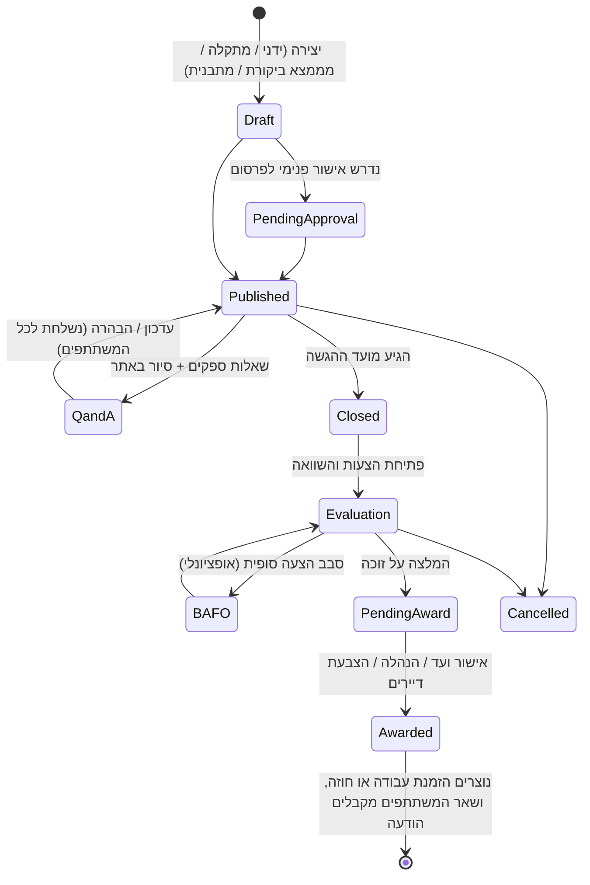

# 10. מודול RFQ — בקשות להצעות מחיר ומכרזים

## 10.1 מטרה

לאפשר לכל גורם מורשה במערכת **לפרסם בקשה להצעת מחיר (RFQ)** ולקבל הצעות מבעלי מקצוע, להשוות ביניהן בצורה שקופה ולבחור זוכה. ההצעה הזוכה הופכת אוטומטית להזמנת עבודה או לחוזה שירות.

## 10.2 רמות פרסום (מי יכול להעלות RFQ)

| רמה | מי מפרסם | דוגמאות | מי מאשר זכייה |
|-----|----------|---------|----------------|
| **דירה / יחידה** | דייר, נציג חברה במשרדים | שיפוץ מטבח, תיקון מזגן פרטי, התקנת מיגון | הדייר עצמו |
| **מבנה** | ועד בית, מנהל נכס | צביעת חדר מדרגות, החלפת משאבה, תיקון גג | ועד (לפי כללי אישור, למשל רוב חברי ועד או הצבעת דיירים מעל סכום מסוים) |
| **תיק מבנים (Portfolio)** | חברת ניהול | חוזה ניקיון ל-20 מבנים, חוזה שירות מעליות שנתי, הדברה | הנהלת חברת הניהול, ולפי הצורך גם הוועדים |
| **ממצא ביקורת / תקלה** | נוצר מתוך תקלה או ממצא של מבקר בטיחות | תיקון ליקויי כיבוי אש מדוח ביקורת | כמו ברמת המבנה |
| **פלטפורמה** [P3] | אתה (מפעיל המערכת) | רכש מרוכז לכמה לקוחות (למשל מחיר מוזל לבדיקות מעליות) | לפי הסכם |

ההרשאה לפרסם RFQ ניתנת לפי תפקיד. כל Tenant מגדיר:
- **ספי סכום**: עד ₪X ההצעה מספיקה, מעל ₪Y נדרשות לפחות 3 הצעות, ומעל ₪Z נדרשת הצבעת דיירים.
- **מספר הצעות מינימלי** לפני שמותר לבחור זוכה.

## 10.3 סוגי RFQ

| סוג | תיאור |
|-----|--------|
| **עבודה חד-פעמית** | תיקון או התקנה בודדים |
| **פרויקט** | שיפוץ עם כתב כמויות (BOQ), שלבי ביצוע ואבני תשלום |
| **חוזה שירות תקופתי** | ניקיון, גינון, מעליות, הדברה: מחיר חודשי, SLA ותקופה |
| **הסכם מסגרת** | מחירון יחידות (לשעה או לפריט) לשימוש חוזר לאורך תקופה |
| **בקשה מהירה (Quick Quote)** | טופס קצר עם תמונות ותיאור, מיועד לדיירים ולתקלות דחופות |

## 10.4 היקף ההפצה

- **סגור (בהזמנה)**: נשלח רק לספקים שנבחרו ידנית.
- **מאגר מאושר**: לכל הספקים המאושרים של ה-Tenant בתחום הרלוונטי.
- **פתוח (Marketplace)** [P3]: לכל ספק רשום בפלטפורמה לפי תחום, אזור גאוגרפי, דירוג מינימלי ורישיון בתוקף.
- **סינון חובה**: ספק עם רישיון או ביטוח שפג תוקפו אינו יכול להגיש הצעה בתחום הרלוונטי.

## 10.5 תהליך

### צד המפרסם
- [P2] יצירת RFQ: כותרת, תיאור, תחום, מיקום (מבנה, דירה, נכס), תמונות ומסמכים (תכניות, דוח ליקויים), כתב כמויות, מועד הגשה, מועד ביצוע רצוי, תנאי תשלום, אחריות נדרשת, ביטוח נדרש, ותוקף מינימלי להצעה.
- [P2] תבניות RFQ מוכנות (צביעת חדר מדרגות, חוזה ניקיון, החלפת משאבה).
- [P2] מועד לסיור באתר, עם רישום של הספקים המשתתפים.
- [P2] מענה לשאלות: התשובות מפורסמות לכל המשתתפים באופן אנונימי, כדי ששום ספק לא יקבל יתרון.
- [P2] **טבלת השוואה**: מחיר כולל ולפי סעיף, לוח זמנים, אחריות, תנאי תשלום, דירוג הספק במערכת, מספר העבודות הקודמות שביצע, זמן התגובה הממוצע שלו ותוקף הרישיון.
- [P2] **ניקוד משוקלל** שניתן להגדרה, למשל מחיר 50%, דירוג 25%, לוח זמנים 15% ואחריות 10%. המערכת מסמנת אוטומטית הצעות חריגות (נמוכות או גבוהות במידה חשודה).
- [P2] בחירת זוכה עם נימוק, תהליך אישור (חתימות של חברי ועד או הצבעה), והודעה אוטומטית לכל המשתתפים.
- [P3] משא ומתן או סבב הצעה סופית (BAFO) מול הספקים המובילים.

### צד בעל המקצוע
- [P2] **לוח RFQ**: בקשות שהוזמן אליהן, ובשלב 3 גם בקשות פתוחות לפי תחום ואזור. אפשר לסנן ולהירשם להתראות.
- [P2] הבעת עניין, הרשמה לסיור באתר ושאלות הבהרה.
- [P2] **הגשת הצעה**: מחיר לפי סעיף (כתב כמויות) או מחיר כולל, מע"מ, לוח זמנים, אחריות, תנאי תשלום, תוקף ההצעה, קבצים מצורפים (הצעה רשמית, קטלוגים) והערות.
- [P2] עריכה או משיכה של ההצעה עד מועד ההגשה.
- [P2] התראות על הבהרות, שינוי מועדים ותוצאה (זכייה או אי-זכייה). בהסכמת המפרסם, הספק יכול לקבל גם משוב או את טווח המחירים שהוגשו.
- [P2] היסטוריה וסטטיסטיקה אישית: כמה הצעות הגיש, אחוז הזכייה וסכומים.

### צד הדייר (שקיפות)
- [P2] בעבודות ברמת המבנה מעל סף מוגדר, הדיירים יכולים לראות את ההצעות שהתקבלו ואת נימוק הבחירה, ולהשתתף בהצבעה אם הוגדרה כזו.

## 10.6 הגינות ושקיפות

- **מעטפות סגורות**: המפרסם לא רואה תוכן או מחירים של הצעות עד מועד ההגשה, רק את מספר ההצעות שהתקבלו. אפשר לבטל את זה בבקשות מהירות.
- **חותמת זמן** לכל הגשה, ותיעוד של כל צפייה ושינוי ביומן הביקורת (Audit Log).
- **הצהרת ניגוד עניינים** של חברי ועד ומנהלים לפני בחירת הזוכה.
- שום ספק אינו רואה הצעות של ספקים אחרים.
- **ארכיון** RFQ סגורים לכל ההיסטוריה של המבנה, לצורכי ביקורת ואסיפה כללית.

## 10.7 קישור למודולים אחרים

| מודול | חיבור |
|-------|-------|
| תקלות | כפתור "בקש הצעות מחיר" מתוך תקלה. זמן ה-SLA מושהה בסטטוס "ממתין להצעות" (לפי הגדרה) |
| ביקורות | בחירת כמה ממצאים ויצירת RFQ אחד שמרכז את כל הליקויים |
| אחזקה מונעת | חידוש חוזה שירות שעומד לפוג פותח טיוטת RFQ אוטומטית 60 יום מראש |
| ספקים | הזוכה נוסף אוטומטית למאגר המאושר עם המחירון מתוך ההצעה |
| כספים | הסכום הזוכה נכנס לתקציב או להוצאות, וחיוב מיוחד לדיירים נוצר לפי הצורך |
| מסמכים | ההצעה הזוכה והחוזה נשמרים במאגר המסמכים של המבנה |
| סטטיסטיקה | מחירי שוק ממוצעים לפי סוג עבודה ואזור, באופן אנונימי, לפחות 10 בניינים בכל נתון |

## 10.8 מדדים

- מספר ההצעות הממוצע לכל RFQ.
- הזמן מפרסום עד בחירת זוכה.
- הפער בין ההצעה הזולה ליקרה.
- החיסכון לעומת המחיר הממוצע בשוק.
- אחוז ה-RFQ שהגיעו לזכייה, ואחוז הזכייה של כל ספק.
