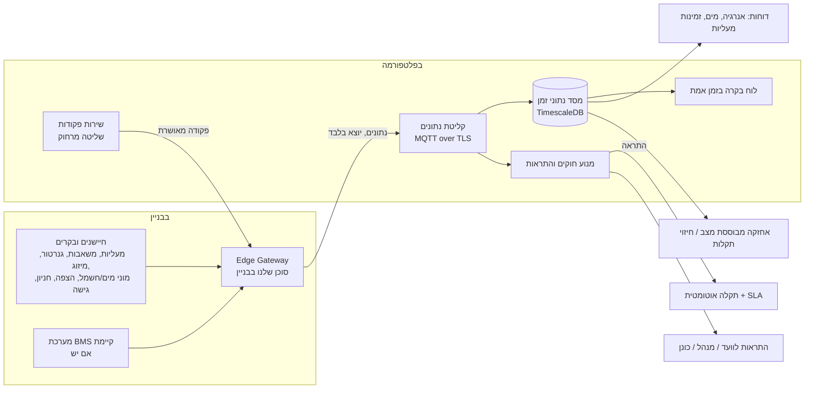

# 11. בניין חכם: ניטור, שליטה, בקרה ודיווח

## 11.1 איפה זה נכנס במערכת

המודול מחבר את **העולם הפיזי** (מערכות הבניין והחיישנים) לשאר המערכת:



**נקודות החיבור לשאר המודולים:**

| מודול קיים | מה מקבל מהבניין החכם |
|-------------|------------------------|
| **תקלות** | התראה מחיישן פותחת תקלה אוטומטית עם חומרה ו-SLA, למשל "חיישן הצפה בחדר משאבות" ← חומרה S1. כשהחיישן חוזר לתקין, התקלה מסומנת לבדיקה |
| **נכסים (Assets)** | כל חיישן ונקודת מדידה משויכים לנכס: מעלית A, משאבה 2, גנרטור |
| **אחזקה מונעת** | טיפול לפי שעות עבודה או מחזורים בפועל ("כל 500 שעות"), ולא רק לפי לוח שנה |
| **ספקים** | ספק המעליות רואה בזמן אמת את מצב המעליות שהוא אחראי עליהן, ומקבל קריאה אוטומטית |
| **כספים** | מוני מים וחשמל משותפים מחולקים לפי דירה או משרד. במשרדים, שעות מיזוג נוספות מחויבות אוטומטית |
| **מבקר בטיחות** | נתונים היסטוריים: בדיקות תאורת חירום, לחץ במערכת הכיבוי, אוורור חניון (CO) |
| **סטטיסטיקה** | זמינות מעליות, צריכת אנרגיה למ"ר, תקלות לפי סוג ציוד, באופן אנונימי |
| **RFQ** | נתוני צריכה ותקלות מצורפים לבקשה, למשל החלפת משאבה שנכשלה 4 פעמים ברבעון |

## 11.2 מה מנטרים ומה שולטים

| מערכת | ניטור (קריאה) | שליטה (כתיבה) | הערות |
|--------|----------------|-----------------|--------|
| מעליות | מצב, תקלה, אדם לכוד, מספר נסיעות, דלתות | ❌ | שליטה רק דרך ספק המעליות |
| משאבות מים וביוב, מאגרים | פעילה/תקלה, לחץ, מפלס, שעות עבודה | ✅ הפעלה ואיפוס (בהרשאה) | |
| חיישני הצפה ונזילה | התראה | ✅ סגירת ברז ראשי חשמלי | פעולה אוטומטית מקומית אפשרית |
| גנרטור | מצב, דלק, הפעלה בבדיקה | ✅ הפעלת בדיקה מתוזמנת | |
| מיזוג מרכזי / HVAC | טמפרטורה, מצב, צריכה | ✅ נקודות קבע ולוחות זמנים | חשוב במיוחד במשרדים |
| תאורה משותפת | מצב, צריכה | ✅ לוחות זמנים | |
| מוני חשמל, מים וגז | קריאות, צריכה | ❌ | חלוקה לדיירים |
| חניון | CO, אוורור, תפוסה | ✅ אוורור (כפוף לבקר המקומי) | |
| בקרת כניסה ואינטרקום | אירועי כניסה, דלת פתוחה | ✅ פתיחה מרחוק, הרשאות זמניות לספקים | Check-in אוטומטי של ספק |
| לוח גילוי ומערכת כיבוי אש | מצב, התראה, תקלה | ❌ **לעולם לא** | קריאה בלבד |
| מצלמות | מצב תקינות בלבד | ❌ | בלי וידאו בשלב זה, כדי לא לפגוע בפרטיות |
| לוקרים לחבילות, טעינת רכבים | תפוסה, צריכה | ✅ לפי הספק | P3 |

### בתוך הדירה (בית חכם)
- [P3] הדייר מחבר בהסכמה מכשירים שלו, כמו חיישן נזילה או מונה חכם. הנתונים שייכים לדייר והוועד לא רואה אותם.
- [P3] הדייר יכול לבחור לשתף התראות מסוימות, למשל "נזילה בדירה עלולה להגיע לקומה מתחת".
- [P3] אינטרקום חכם: פתיחת דלת לאורח מהאפליקציה.
- אנחנו **לא** מתחרים במערכות בית חכם (Google Home, Apple Home, בקרים ייעודיים). אנחנו מתממשקים אליהן רק במידה שזה נוגע לבניין.

## 11.3 שליטה בטוחה (עקרונות מחייבים)

1. **מערכות בטיחות חיים** (כיבוי אש, ספרינקלרים, שחרור עשן, מעליות כבאים) **בקריאה בלבד**.
2. **הבקר המקומי תמיד קובע**: הבניין ממשיך לעבוד גם בלי חיבור לענן. הענן רק שולח בקשות, והבקר רשאי לדחות אותן.
3. **פקודות מוגדרות מראש בלבד**, עם טווחים מותרים. אין כתיבה חופשית לרגיסטרים.
4. **הרשאות**: לכל פקודה מוגדר תפקיד מורשה. בפקודות רגישות נדרש **אישור של שני אנשים** ו-2FA.
5. **תיעוד מלא**: מי שלח, מתי, מאיפה, האם הפקודה בוצעה והאם התקבל אישור מהבקר.
6. **חזרה אוטומטית** למצב הקודם בפעולות זמניות, למשל מיזוג נוסף לשעתיים.
7. **ניתוק חירום**: לחצן בבניין ובממשק ניהול שמבטל כל שליטה מרחוק.

## 11.4 Edge Gateway (רכיב בבניין)

- **חומרה**: מחשב תעשייתי קטן (לדוגמה Advantech, Siemens IOT2050, Raspberry Pi CM4 תעשייתי), עם UPS וחיבור סלולרי כגיבוי.
- **תוכנה**: סוכן שנכתוב (מומלץ Go, צריכת משאבים נמוכה) בתוך Docker, עם מנהלי התקן לפרוטוקולים:
  - **BACnet/IP** (רוב מערכות ה-BMS והמיזוג), **Modbus TCP/RTU** (משאבות, גנרטורים, מונים), **KNX** (תאורה), **M-Bus / wM-Bus** (מוני מים וחום), **MQTT** (חיישנים מודרניים), **OPC-UA**, **LoRaWAN** (חיישני סוללה, למשל הצפה), ו-**ממשקי ענן של יצרנים** (ספקי מעליות, מערכות בקרת כניסה).
- **תקשורת**: יוצאת בלבד, דרך MQTT over TLS עם תעודת לקוח לכל Gateway. **אין פתיחת פורטים בבניין.**
- **עבודה בלי חיבור**: הנתונים נשמרים מקומית (ימים עד שבועות) ונשלחים כשהחיבור חוזר. חוקי התראה קריטיים רצים גם מקומית, למשל סגירת ברז בהצפה.
- **ניהול מרחוק**: עדכוני תוכנה חתומים, הגדרות מהענן, ניטור תקינות ה-Gateway עצמו (התראה כשהוא מפסיק לשדר).
- **מיפוי נקודות**: אשף בממשק שמשייך כל נקודה (למשל `AI-3`) לנכס ולסוג מדידה (למשל לחץ במשאבה 2). יש ספריית תבניות לציוד נפוץ.
- **בלי Gateway** (לבניינים קטנים): חיבור ישיר בענן לחיישנים סלולריים או LoRaWAN, או לממשקי ענן של יצרנים.

## 11.5 ממשק ודיווח

**לוח בקרה (Control Room):**
- מפת בניין או רשימת מערכות, עם מצב בזמן אמת בצבעים (תקין / אזהרה / תקלה / אין תקשורת).
- חברת ניהול: תצוגת מוקד לכל הבניינים, עם התראות מרוכזות לפי חומרה.
- גרפים לכל נקודת מדידה עם טווח זמן, סימון ספים ואירועים.
- התראות פעילות: אישור קבלה, השתקה זמנית, קישור לתקלה.
- חיפוש מכשיר לפי בניין, נכס, סוג ומצב.

**דוחות:**
- זמינות מעליות ומשאבות (Uptime) לפי חודש וספק, מול ה-SLA בחוזה.
- צריכת חשמל ומים: מגמות, השוואה לתקופה מקבילה, חלוקה לדיירים, זיהוי חריגות (למשל נזילה סמויה בלילה).
- שעות עבודה של ציוד והשוואה לתכנית האחזקה.
- דוח תגובה להתראות: הזמן מהתראה עד טיפול.
- דוח לאסיפה הכללית: "הבניין במספרים".
- ייצוא לאקסל או PDF ושליחה מתוזמנת במייל.

**חוקי התראה (ניתנים להגדרה לכל לקוח):**
- סף (גבוה/נמוך), שינוי מצב, היעדר נתונים, קצב שינוי, משך (למשל "משאבה פועלת יותר מ-30 דקות ברצף").
- מיפוי התראה לחומרה ולקטגוריית תקלה, ומניעת הצפת התראות (Debounce וקיבוץ).
- [P3] זיהוי חריגות בלמידת מכונה ואחזקה חזויה.

## 11.6 מודל נתונים (תוספת)

| ישות | שדות עיקריים |
|------|---------------|
| **Gateway** | building_id, serial, cert_fingerprint, firmware_version, status, last_seen_at, connectivity (eth/cellular) |
| **Device** | building_id, gateway_id?, asset_id?, protocol, address, manufacturer, model, status |
| **Point** | device_id, key, kind (analog/binary/multistate/counter), unit, writable, allowed_range, safety_class (life_safety/critical/normal) |
| **Telemetry** | point_id, ts, value, quality (טבלת זמן ב-TimescaleDB, דחיסה ושמירה לפי מדיניות) |
| **AlarmRule** | tenant_id, scope (point/asset_type/building), condition (JSON), duration, severity, ticket_category_id, notify (JSON) |
| **Alarm** | rule_id, point_id, raised_at, acknowledged_by/at, cleared_at, ticket_id |
| **CommandDefinition** | point_id / device_type, name, params_schema, required_role, requires_dual_approval, auto_revert_after |
| **Command** | definition_id, requested_by, approved_by, params, status (pending/approved/sent/acked/failed/reverted), sent_at, acked_at |
| **MeterAllocation** | meter_point_id, unit_id, share / formula |

**שמירת נתונים**: נתונים גולמיים נשמרים 90 יום. ממוצעים לפי שעה נשמרים שנתיים, וממוצעים לפי יום נשמרים 7 שנים.

## 11.7 API

```
GET    /api/v1/buildings/:id/devices
GET    /api/v1/points/:id/telemetry?from=&to=&agg=1h
GET    /api/v1/buildings/:id/live              # WebSocket: מצב בזמן אמת
GET    /api/v1/alarms?status=active&building=
POST   /api/v1/alarms/:id/ack
POST   /api/v1/commands                        # בקשת פקודה
POST   /api/v1/commands/:id/approve            # אישור שני אנשים
GET    /api/v1/reports/energy?building=&period=
GET    /api/v1/reports/uptime?asset_type=elevator
# Gateway (mTLS)
MQTT   t/{tenant}/b/{building}/gw/{gw}/telemetry   (gateway → cloud)
MQTT   t/{tenant}/b/{building}/gw/{gw}/cmd         (cloud → gateway)
```

## 11.8 אבטחת סייבר (OT)

- עבודה לפי **IEC 62443** והנחיות **מערך הסייבר הלאומי** למערכות בקרה במבנים.
- רשת ה-Gateway מופרדת מרשת הדיירים (VLAN), והתקשורת יוצאת בלבד.
- זהות לכל Gateway בתעודה, עם אפשרות לבטל אותה מרחוק. אחסון מפתחות בשבב מאובטח (TPM) כשיש.
- עדכוני תוכנה חתומים. אין סיסמאות ברירת מחדל.
- מבדק חדירה ייעודי לרכיב ה-Edge לפני הפריסה הראשונה.

## 11.9 שלבים

| שלב | יכולת |
|-----|--------|
| **MVP (הכנה)** | מודל נכסים שמוכן לחיישנים, אירועים פנימיים (Event Bus), תקלה שנפתחת ממקור "מערכת". בלי חומרה |
| **שלב 3: ניטור** | Gateway ראשון, Modbus ו-BACnet ו-MQTT, חיישני הצפה (LoRaWAN), ניטור משאבות וגנרטור, התראות שפותחות תקלות, לוח בקרה בסיסי |
| **שלב 4: דיווח ומשרדים** | מוני אנרגיה ומים, חלוקה לדיירים, דוחות זמינות, תצוגת מוקד לחברת ניהול, ממשקים ליצרני מעליות |
| **שלב 5: שליטה** | פקודות מוגדרות עם אישור שני אנשים, לוחות זמנים למיזוג ותאורה, מיזוג נוסף בתשלום במשרדים, בקרת כניסה לספקים |
| **שלב 6: חכמה** | אחזקה חזויה, זיהוי חריגות, אופטימיזציית אנרגיה, בית חכם ברמת הדירה |

**מודל עסקי**: מנוי חודשי נוסף לכל בניין או לכל נקודת מדידה, מכירה או השכרה של Gateway וחיישנים, והתקנה דרך שותפים (קבלני חשמל ובקרה), כולל ערכה מוכנה לבניין מגורים.
