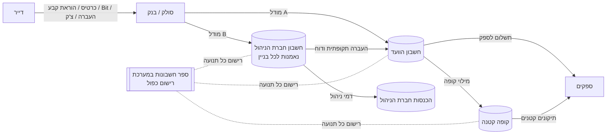

# 12. מודול תשלומים, כספים וקופות

## 12.1 מטרה

לנהל את כל תנועות הכסף של הבניין בצורה שקופה ומבוקרת:
- גבייה מדיירים.
- העברת הכספים לחשבון הנכון (חשבון הוועד או חשבון חברת הניהול).
- קופה קטנה לתיקונים.
- קרנות וחיסכון.
- תשלומים לספקים.
- התאמות בנק ודוחות.

> **עיקרון מרכזי:** הפלטפורמה **לא מחזיקה כסף בעצמה**. הכסף עובר ישירות מהמשלם לחשבון של הוועד או של חברת הניהול, דרך סולק או בנק. כך נמנעים מהצורך ברישיון נותן שירותי תשלום (חוק הסדרת העיסוק בשירותי תשלום ובייזום תשלומים) ומהאחריות על כספי לקוחות. המערכת מנהלת את **הרישום, הבקרה וההתאמה**.

## 12.2 מודלים של זרימת כסף

כל בניין מוגדר לפי אחד המודלים הבאים, ואפשר לשנות מודל לאורך הזמן:

| מודל | איך זה עובד | מתאים ל |
|------|-------------|---------|
| **A. ועד ישיר** | הדיירים משלמים לחשבון הבנק של הוועד, ומסוף הסליקה רשום על שם הוועד | ועדים עצמאיים |
| **B. גבייה ע"י חברת הניהול** | הדיירים משלמים לחשבון חברת הניהול. מומלץ חשבון נאמנות נפרד לכל בניין, או לפחות חשבון מאוחד עם כרטסת נפרדת לכל בניין. חברת הניהול מקזזת דמי ניהול ומוציאה דוח חודשי לוועד | בניינים בניהול מלא |
| **C. מעורב** | דמי ניהול משולמים לחברת הניהול, וקרן הבניין (שיפוצים, קופה קטנה) לחשבון הוועד. חיוב אחד לדייר מתפצל לשני יעדים | נפוץ במגדלים |
| **D. תשלום פרטי לספק** [P3] | דייר משלם לבעל מקצוע על עבודה בדירה, דרך סולק שתומך בפיצול תשלומים (Marketplace). העמלה לפלטפורמה מנוכה אוטומטית | Marketplace |

## 12.3 ספר חשבונות (Ledger)

- **רישום כפול (Double-Entry)** לכל בניין. כל תנועה רושמת חובה וזכות, והיתרות תמיד מתאזנות. זה הבסיס לדוחות אמינים ולביקורת רואה חשבון.
- **רשומות בלתי ניתנות למחיקה**: תיקון נעשה בפקודת סטורנו (ביטול), והמקור לא נמחק.
- **סגירת תקופה**: נעילת חודש או שנה אחרי התאמה. פתיחה מחדש מותרת רק בהרשאה ומתועדת.

**מבנה חשבונות לבניין (ברירת מחדל, ניתן להתאמה):**

| קבוצה | חשבונות |
|-------|---------|
| נכסים | חשבונות בנק (יכולים להיות כמה), קופה קטנה (יכולות להיות כמה), צ'קים לגבייה, סולק (כספים בדרך), חייבים: דיירים (כרטסת לכל דירה) |
| התחייבויות | ספקים לתשלום, חברת הניהול לתשלום (במודל B), תשלומים מראש מדיירים, פיקדונות (שיפוץ, מפתחות) |
| קרנות (Funds) | קרן שוטפת, **קרן שיפוצים / רזרבה**, קרנות ייעודיות לפרויקטים (החלפת מעלית, איטום גג) |
| הכנסות | דמי ועד, חיובים מיוחדים, קנסות פיגור, השכרת שטחים משותפים (אנטנות סלולריות, גג, שילוט), ריבית |
| הוצאות | ניקיון, חשמל משותף, מים, מעליות, גינון, ביטוח, תיקונים, דמי ניהול, עמלות בנק וסליקה |

**קרנות**: כל חיוב משויך לקרן, למשל ₪250 לחודש: ₪200 לקרן השוטפת ו-₪50 לקרן השיפוצים. הוועד רואה את יתרת כל קרן בנפרד, ואפשר לחסום שימוש בקרן ייעודית בלי החלטת אסיפה.

## 12.4 גבייה מדיירים

- **כללי חיוב**: סכום קבוע, לפי מ"ר, לפי חלק ברכוש המשותף, או לפי סוג יחידה (דירה, מחסן, חניה, משרד, חנות). לכל כלל יש קרן יעד ויעד כספי (ועד או חברת ניהול).
- **הפקת חיובים** חודשית, רבעונית או שנתית, וחיובים מיוחדים חד-פעמיים עם פריסה לתשלומים.
- **ייחוס תשלום** לחיובים לפי הישן קודם (FIFO) או ידנית. תשלום חלקי, יתרת זכות, הנחה (למשל על תשלום שנתי מראש) וזיכוי.
- **אמצעי תשלום**:
  - כרטיס אשראי (טוקניזציה אצל הסולק בלבד), כולל הוראת קבע באשראי.
  - **הרשאה לחיוב חשבון (מס"ב)**: הפקת קובץ חיובים חודשי וקליטת החזרות.
  - Bit, PayBox, Apple Pay ו-Google Pay דרך הסולק.
  - העברה בנקאית עם אסמכתה ייחודית לדירה, שמאפשרת התאמה אוטומטית.
  - מזומן, ו**צ'קים כולל צ'קים דחויים**: מעקב לפי תאריך פירעון, הפקדה, וצ'ק שחזר.
- **קבלות ואישורים**:
  - ועד בית שאינו עוסק מפיק "אישור תשלום" ממוספר.
  - חברת ניהול (עוסק) מפיקה חשבונית מס או קבלה דרך אינטגרציה (חשבונית ירוקה, iCount). **צריך לאמת מול רואה חשבון את סוג המסמך הנדרש בכל מודל.**
- **כרטסת דייר**: הדייר רואה את כל החיובים, התשלומים והיתרה, ויכול להוריד אישורים.
- **בעלים מול שוכר**: הגדרה מי משלם כל סוג חיוב. למשל, בעל הדירה משלם את קרן השיפוצים והשוכר משלם את השוטף.

### טיפול בחובות
- תזכורות מדורגות: 7 ימים אחרי המועד, 30 יום ו-60 יום, בתבניות שניתנות לעריכה ובערוצים שונים.
- **הסדר חוב**: פריסת חוב לתשלומים ומעקב אחרי העמידה בהם.
- ריבית או קנס פיגור, רק אם התקנון מאפשר. החישוב מוגדר לכל בניין.
- מכתב התראה לפני נקיטת הליכים, הפקת דוח חוב מפורט והעברה לעורך דין (ייצוא תיק). הסטטוס מסומן כ"בטיפול משפטי".
- דוח גיול חובות: 0–30, 31–60, 61–90 ו-90+ יום.

### 12.4.1 תהליך חיוב: מועדים, התראות וסנקציות

**לכל תהליך חיוב** יש הגדרה מלאה של מועדים, התראות וסנקציות. זה נכון לחיוב חודשי, לחיוב מיוחד (שיפוץ, פרויקט, מצב מיוחד), לקנס ולהסדר חוב.

| רכיב | מה מגדירים |
|------|-------------|
| **פרטי החיוב** | שם, סוג, קרן יעד, יעד כספי (ועד או חברת ניהול), סכום כולל ושיטת חלוקה (שווה, לפי מ"ר, לפי חלק ברכוש המשותף, ידני), בעלים או שוכר, מקור (החלטת אסיפה, מצב מיוחד, RFQ זוכה) |
| **מועדים** | תאריך הפקה, **מועד תשלום** לכל תשלום, **מועד סיום לתהליך כולו**, ומספר תשלומים עם תאריכים. אפשר לבחור תשלום מלא מראש עם הנחה |
| **התראות** | לוח תזכורות לפני המועד, ביום המועד ואחריו (למשל 7 ימים לפני, ביום, 7, 30 ו-60 יום אחרי), לפי ערוץ וקבוצה (מסמך 17). בנוסף: התראה לוועד על חייבים ודוח מצב לפני מועד הסיום |
| **סנקציות** | ראה מדיניות סנקציות בהמשך |
| **סגירה** | במועד הסיום: דוח מסכם (נגבה, חוב פתוח, סנקציות שנצברו), והעברת חובות פתוחים לשלב הבא במדרג הגבייה |

**מדיניות סנקציות** (ניתנת להגדרה ברמת לקוח, בניין וסוג חיוב):
- **תקופת חסד**: ימים אחרי המועד שבהם לא מופעלת סנקציה.
- **ריבית פיגורים**: שיעור שנתי, שיטת חישוב (פשוטה, יומית או חודשית), מועד תחילה ותקרה.
- **הצמדה למדד** (אופציונלי).
- **קנס קבוע** על איחור, חד-פעמי או חודשי, עם תקרה.
- **מדרג גבייה**: תזכורת ← התראה ← מכתב התראה רשמי ← פנייה של הוועד ← העברה לטיפול משפטי. לכל שלב יש מועד ופעולה.
- **ויתור או הנחה על סנקציה**: רק בהרשאה, עם נימוק, ונרשם ביומן הביקורת.
- **בסיס משפטי חובה**: סנקציה מופעלת רק אם קיים בסיס בתקנון או בהחלטת אסיפה. המסמך מקושר להגדרה. **שיעורי ריבית ותקרות ייבדקו מול עורך דין**, כולל החוקים החלים על ריבית והצמדה.
- **לא חוסמים שירותים חיוניים** (מים, חשמל, מעלית, תיקון תקלה) בגלל חוב. חסימת שירותים לא חיוניים, כמו הזמנת מתקנים, אפשרית רק לפי החלטה ובדיקה משפטית.

**רישום**: ריבית וקנסות נצברים כחיובים רגילים בספר החשבונות (מסמך 12.3). ויתור נרשם כפקודת זיכוי, לא כמחיקה.

## 12.5 קופה קטנה (Petty Cash)

- **הגדרה**: לכל קופה יש אחראי (אב בית, חבר ועד או מנהל נכס), תקרת יתרה, תקרה לפריט בודד וקטגוריות מותרות.
- **שיטת מקדמה קבועה (Imprest)**: הקופה מתמלאת מחשבון הבנק עד הסכום הקבוע, לפי סכום הקבלות שהוגשו.
- **רישום הוצאה מהנייד**: צילום קבלה, זיהוי אוטומטי של סכום, ספק ותאריך (OCR), קטגוריה, ושיוך לתקלה או להזמנת עבודה אם יש.
- **אישורים**: הוצאה מעל ₪X דורשת אישור של חבר ועד נוסף. במילוי הקופה נבדקות כל הקבלות.
- **ספירת קופה** תקופתית: האחראי מזין את היתרה בפועל, המערכת משווה לרישום ומסמנת כל פער.
- **התראות**: יתרה נמוכה, קבלה חסרה, הוצאה חריגה, או הוצאה ללא שיוך.
- **דוח קופה** חודשי לוועד.
- **קופה דיגיטלית** [P2]: כרטיס חיוב נטען (Prepaid) לאחראי, עם משיכת עסקאות אוטומטית מהמנפיק.

## 12.6 הוצאות ותשלום לספקים

- **קליטת חשבונית**: העלאה ידנית, הגשה ע"י הספק בפורטל, או שליחה במייל לכתובת ייעודית של הבניין עם OCR.
- **התאמה משולשת**: הזמנת עבודה או RFQ זוכה, מול חשבונית, מול אישור ביצוע. המערכת מתריעה על חריגה מהסכום שאושר.
- **תהליך אישור לפי סכום**: עד ₪X מנהל נכס, עד ₪Y גזבר, ומעל ₪Y שני מורשי חתימה, בדומה למורשי חתימה בבנק.
- **ביצוע תשלום**:
  - רישום של העברה שבוצעה בבנק.
  - [P2] הפקת קובץ מס"ב זכות לתשלומים מרוכזים.
  - [P3] ייזום תשלום דרך בנקאות פתוחה.
- **הגנה מהונאת שינוי פרטי בנק**: שינוי חשבון בנק של ספק דורש אימות טלפוני חוזר במספר שכבר שמור במערכת, אישור של שני אנשים ותקופת המתנה. לספק נשלחת התראה על השינוי.
- **ניכוי מס במקור**: שמירת אישור ניכוי במקור של הספק ותוקפו, והתראה כשאין אישור.
- **תקציב**: כל הוצאה משויכת לסעיף תקציבי, והמערכת מתריעה כשהסעיף מתקרב למיצוי.

## 12.7 חברת ניהול: התחשבנות מול הבניין

- כרטסת נפרדת לכל בניין בתוך חשבון החברה.
- **חישוב דמי ניהול**: סכום קבוע, לפי יחידה, לפי מ"ר או אחוז מהגבייה. הקיזוז אוטומטי והחשבונית מופקת.
- **דוח חודשי לוועד**: מה נגבה, מה הוצא, מה קוזז, ומה היתרה בנאמנות.
- **העברות לחשבון הוועד** לפי לוח זמנים או לפי בקשה, עם אישור.
- **מעבר בין חברות ניהול**: דוח סגירה ויתרות פתיחה לחברה הבאה, ויצוא מלא של הנתונים.

## 12.8 התאמות בנק

- **ייבוא תנועות בנק**:
  - קובץ CSV או Excel מכל בנק.
  - [P2] חיבור API דרך גופים מורשים לפי רגולציית הבנקאות הפתוחה בישראל.
- **התאמה אוטומטית**: לפי אסמכתה, סכום, שם המשלם ותאריך, וגם לפי למידה מהתאמות קודמות.
- **תור לא מותאמים**: הגזבר משייך ידנית, והמערכת זוכרת את הכלל לפעם הבאה.
- **התאמת סולק**: עסקאות מול הפקדות נטו, אחרי עמלות ועסקאות שבוטלו.

## 12.9 דוחות

| דוח | למי | תדירות |
|-----|-----|---------|
| מצב גבייה ואחוז גבייה | ועד, חברת ניהול | זמן אמת + שבועי |
| גיול חובות | ועד, גזבר | חודשי |
| תזרים מזומנים ותחזית | ועד, חברת ניהול | חודשי |
| תקציב מול ביצוע | ועד, אסיפה כללית | רבעוני, שנתי |
| יתרות קרנות | ועד | חודשי |
| קופה קטנה | ועד | חודשי |
| דוח שנתי לאסיפה הכללית (הכנסות, הוצאות, קרנות, חובות) | כל הדיירים | שנתי |
| כרטסת דייר | דייר | לפי דרישה |
| התחשבנות חברת ניהול מול בניין | ועד | חודשי |
| ייצוא לרואה חשבון (פקודות יומן, כרטסות, מע"מ) | חברת ניהול, רו"ח | חודשי, שנתי |

## 12.10 הרשאות כספיות

| תפקיד | יכולות |
|-------|---------|
| גזבר / מנהל כספים | רישום, התאמה, הפקת חיובים, דוחות |
| מורשה חתימה | אישור תשלומים ושינוי פרטי ספק |
| אחראי קופה | הוצאות מהקופה, ספירה |
| חבר ועד | צפייה בכל הדוחות |
| רואה חשבון (חיצוני) | צפייה וייצוא בלבד, בהרשאה מוגבלת בזמן |
| דייר | הכרטסת שלו, ודוחות מסכמים שהוועד פרסם |

כל פעולה כספית נרשמת ביומן הביקורת (Audit Log). שינויים רגישים דורשים אימות נוסף ברגע הפעולה (Step-up), ראה [מסמך 13](13-cyber-security-auth.md).

## 12.11 מודל נתונים (תוספת)

| ישות | שדות עיקריים |
|------|---------------|
| **MoneyFlowConfig** | building_id, model (A/B/C), collector_account_id, fee_rules (JSON) |
| **LedgerAccount** | building_id, code, name, type (asset/liability/fund/income/expense), parent_id, fund_id? |
| **Fund** | building_id, name, purpose, restricted, target_amount |
| **JournalEntry** | building_id, date, description, source_type/id (payment/expense/transfer/adjustment), status (posted/reversed), period_locked |
| **JournalLine** | entry_id, account_id, debit, credit, unit_id? |
| **BankAccount** | owner (tenant/building), bank, branch, account_no (מוצפן), purpose, is_trust |
| **BankTransaction** | bank_account_id, date, amount, reference, counterparty, matched_entry_id, match_status |
| **PettyCashBox** | building_id, custodian_user_id, float_amount, max_item_amount, balance |
| **PettyCashExpense** | box_id, amount, receipt_attachment_id, ocr_data, category, ticket_id?, status (pending/approved/rejected) |
| **CashCount** | box_id, counted_amount, expected_amount, diff, counted_by, at |
| **Check** | payer, bank, number, amount, due_date, status (held/deposited/cleared/bounced) |
| **PaymentPlan** | unit_id, total, installments (JSON), status |
| **ChargePlan** | building_id, name, type (monthly/special/fine/settlement), fund_id, collector, total, split_method, payer_role, source (assembly_decision/state/rfq), source_id, issue_date, installments (JSON: due dates), end_date, reminder_policy_id, sanction_policy_id, status (draft/active/closed) |
| **ReminderPolicy** | tenant_id, building_id?, offsets_days[] (לפני ואחרי המועד), channels, audience, committee_alerts |
| **SanctionPolicy** | tenant_id, building_id?, charge_type?, grace_days, interest_annual_rate, interest_method, indexation, late_fee_amount, late_fee_recurring, cap, escalation_steps (JSON), legal_basis_doc_id |
| **SanctionAccrual** | charge_id, policy_id, period, amount, journal_entry_id, waived_by?, waiver_reason? |
| **VendorInvoice** | vendor_id, building_id, work_order_id?, amount, vat, doc_id, approval_status, paid_status |
| **VendorBankChange** | vendor_id, old/new (מוצפן), verified_by, approved_by, effective_at |
| **ApprovalPolicy** | scope, action, amount_from/to, required_roles[], min_approvers |
