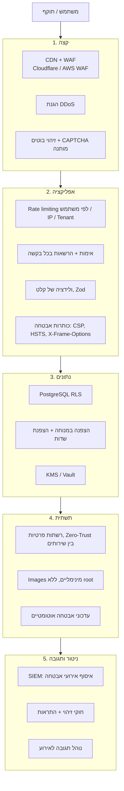

# 13. מודול סייבר ואימות זהות

> המסמך מרחיב את [מסמך 7](07-security-privacy.md). מסמך 7 מגדיר תפקידים ופרטיות, והמסמך הזה מגדיר את מודול האימות ואת ההגנה מפני תקיפות.
>
> **למה זה קריטי כאן**: המערכת מחזיקה פרטים אישיים של דיירים, כסף ופרטי בנק, מסמכים, ושליטה במערכות פיזיות (מסמך 11). היא מטרה אטרקטיבית לכופרה, להונאות תשלום ולגורמים עוינים.

## 13.1 מודול אימות (Identity & Access)

שירות זהות מרכזי ונפרד לוגית (בתוך ה-Monolith כמודול `identity`). אפשר להחליף אותו ב-Keycloak או Ory בהמשך בלי לשנות את שאר המערכת, כי הממשק הוא OIDC סטנדרטי.

### שיטות כניסה
| שיטה | למי | הערות |
|------|-----|-------|
| **OTP ב-SMS או מייל** | דיירים | 6 ספרות, תוקף 5 דקות, עד 5 ניסיונות, הגבלת קצב לפי מספר ולפי IP |
| **Passkeys (WebAuthn)** | כולם, מומלץ | בלי סיסמה ועמיד לפישינג. כניסה בטביעת אצבע או זיהוי פנים בטלפון |
| **סיסמה + 2FA** | ועד, מנהלים, ספקים, מבקרים | סיסמה של 12 תווים לפחות, בדיקה מול רשימת סיסמאות שדלפו (HIBP k-anonymity), Argon2id. אפליקציית אימות (TOTP) או Passkey כגורם שני. SMS כגורם שני רק כגיבוי |
| **SSO** (OIDC / SAML) | חברות ניהול, מגדלי משרדים | Azure AD / Entra, Google Workspace, Okta. הקמה וביטול משתמשים אוטומטיים (SCIM) [P3] |
| **קישור קסם (Magic link)** חד-פעמי | ספקים בביצוע עבודה בודדת | מוגבל להזמנת העבודה הספציפית בלבד, ופג בסיומה |
| **מפתח API או OAuth Client Credentials** | גורמי חוץ, אינטגרציות | Scopes, מכסות, החלפת מפתחות תקופתית |
| **תעודת mTLS** | Edge Gateways | לכל Gateway תעודה משלו, וניתן לבטל אותה |

### מדיניות 2FA לפי תפקיד
- **חובה**: מנהלי פלטפורמה, מנהלי Tenant, גזברים, מורשי חתימה, מבקרים, ומי שמורשה לשלוח פקודות לבניין חכם.
- **מומלץ**: חברי ועד, ספקים.
- **אופציונלי**: דיירים.

### אימות נוסף ברגע הפעולה (Step-up)
פעולות רגישות דורשות אימות מחדש גם בתוך סשן פעיל:
- אישור תשלום, ושינוי פרטי בנק של ספק או של הוועד.
- ייצוא רשימת דיירים או נתונים כספיים.
- שליחת פקודה לבניין חכם.
- שינוי הרשאות, הוספת מנהל, שינוי שיטות אימות.
- כניסת תמיכה לחשבון לקוח (Impersonation).

### ניהול סשנים ומכשירים
- Access Token קצר (15 דק') ו-Refresh Token מסובב עם זיהוי שימוש חוזר בטוקן, שמעיד על גניבה.
- Cookie מסוג `HttpOnly` + `Secure` + `SameSite` באפליקציית ה-Web, ולא אחסון ב-localStorage.
- רשימת מכשירים פעילים, ניתוק מרחוק, והתראה על כניסה ממכשיר או ממדינה חדשים.
- ניתוק אוטומטי אחרי זמן חוסר פעילות לפי תפקיד: 30 דקות לפעולות כספיות, 30 יום לדייר במכשיר מוכר.

### שחזור חשבון
- שחזור באמצעות גורם שני שעדיין זמין, או קודי גיבוי.
- לתפקידים בכירים: שחזור ידני דרך התמיכה עם אימות זהות, המתנה של 24 שעות והתראה לשאר המנהלים.
- **אין שחזור באמצעות SMS בלבד** לחשבונות עם הרשאות כספיות. זה מגן מפני גניבת מספר טלפון (SIM swap).

### הרשאות
- הרשאות לפי תפקיד ולפי היקף (RBAC + ABAC), ו-RLS במסד הנתונים כשכבה שנייה (מסמך 7).
- **הרשאה מינימלית**: הרשאות זמניות לספקים ולמבקרים פגות אוטומטית.
- **הפרדת סמכויות**: אותו אדם לא יכול גם ליצור ספק וגם לאשר לו תשלום.
- **סקירת הרשאות תקופתית**: דוח רבעוני לכל לקוח עם רשימת מי מחזיק איזו הרשאה, ואישור או הסרה בלחיצה.

### 13.1.1 הרשאות מפורטות בתוך ארגון (ועד, חברת ניהול)

בוועד יש כמה אנשים, ובחברת ניהול יש צוות. **לכל אחד הרשאות שונות**, ולכן המודל בנוי משלוש שכבות:

1. **פעולה (Permission)**: יחידת הרשאה קטנה, למשל `finance.payments.record`, `finance.payments.approve`, `residents.manage` (הכנסה והוצאה של דיירים), `companies.manage` (חברות במשרדים), `tickets.assign`, `vendors.manage`, `documents.view_restricted`, `building.profile.edit`, `decisions.manage`, `legal.cases.view`, `reports.export`, `users.manage`.
2. **תפקיד (Role)**: אוסף פעולות. יש תבניות מוכנות, וכל לקוח יכול לשכפל תבנית ולערוך אותה, או ליצור תפקיד חדש.
3. **שיוך (Assignment)**: משתמש × תפקיד × **היקף** × זמן. ההיקף יכול להיות כל הארגון, **קבוצת בניינים**, בניין אחד, או יחידה.

**תבניות תפקידים לדוגמה**

| ארגון | תפקיד | הרשאות עיקריות | היקף טיפוסי |
|-------|-------|-----------------|---------------|
| ועד | יו"ר ועד | הכול בבניין, כולל ניהול משתמשי הוועד | בניין |
| ועד | גזבר | כספים: רישום, התאמות, דוחות. אישור תשלומים כמורשה חתימה | בניין |
| ועד | אחראי דיירים | הכנסה והוצאה של דיירים ובעלים, עדכון פרטים, הזמנות | בניין |
| ועד | אחראי תחזוקה | תקלות, ספקים, RFQ. אין גישה לכספים | בניין |
| ועד | חבר ועד | צפייה, ובלי פעולות כספיות | בניין |
| חברת ניהול | מנכ"ל / מנהל | הכול בארגון, כולל משתמשים, הגדרות ו-QC | ארגון |
| חברת ניהול | רואה חשבון / מנהל כספים | כספים בכל הבניינים: התאמות, חשבוניות, דמי ניהול, ייצוא. אין תפעול | ארגון |
| חברת ניהול | מנהל נכס | תפעול מלא, ובכספים: רישום בלבד | קבוצת בניינים |
| חברת ניהול | אב בית | תקלות, סיורים, קופה קטנה, דיווח הגעה | **כמה בניינים** |
| חברת ניהול | מוקדן | פתיחה ושיבוץ של תקלות בכל הבניינים, בלי כספים | ארגון |
| חברת ניהול | נציג מכירות / הטמעה | הקמת בניינים חדשים, ייבוא נתונים | ארגון |
| משרדים | נציג חברה | הכנסה והוצאה של עובדי החברה, תקלות, חיובים של החברה | יחידות החברה |

**עקרונות**
- **הקוד בודק פעולה ולא שם תפקיד.** הבדיקה היא "האם מותר `finance.payments.approve` בבניין X", ולא "האם הוא גזבר". כך תפקידים מותאמים עובדים בלי לשנות קוד.
- **קבוצות בניינים** מוגדרות בחברת ניהול, למשל "אזור צפון" או "תיק של יוסי". אב בית משויך לקבוצה, וכל בניין שנוסף לקבוצה מתווסף להרשאות שלו אוטומטית.
- **הפרדת סמכויות** (סעיף 13.1): כללים שאי אפשר לעקוף בתפקיד מותאם, למשל אותו אדם לא יוצר ספק ומאשר לו תשלום. אישור כפול דורש שני אנשים שונים.
- **האצלה זמנית**: יו"ר יכול להעביר הרשאות לממלא מקום לתקופה מוגדרת, למשל בזמן חופשה. ההאצלה פגה אוטומטית.
- **כניסה ויציאה מתפקיד**: חבר ועד שמסיים כהונה מאבד הרשאות מיד, וההיסטוריה שלו נשמרת. זה מתחבר להחלטות בחירת נציגות (מסמך 22).
- **שקיפות**: מסך "מי יכול מה" לכל בניין, וסקירת הרשאות רבעונית.
- **הכול ביומן הביקורת**: כל שינוי הרשאה נרשם.

## 13.2 הגנה רב-שכבתית

## 13.3 רכיבי המודול

| רכיב | תיאור | שלב |
|------|--------|-----|
| **WAF ו-DDoS** | Cloudflare או AWS Shield/WAF, עם חוקי OWASP CRS וחוקים ייעודיים לנקודות הכניסה (OTP, Login) | MVP |
| **הגבלת קצב (Rate Limiting)** | ב-Redis (Sliding window), לפי משתמש, IP, Tenant ו-API Key. מכסות מחמירות בנקודות OTP, Login וייצוא | MVP |
| **זיהוי ניסיונות חדירה לחשבונות** | ניסיונות כושלים, Credential Stuffing ממקורות רבים, "נסיעה בלתי אפשרית" (כניסות ממקומות רחוקים בהפרש זמן קצר), חסימה זמנית והתראה | MVP |
| **הגנת OTP** | חסימת שליחה המונית של SMS לחשבון התוקף (SMS Pumping): הגבלה לפי קידומת ומדינה, CAPTCHA אחרי X בקשות, תקרת עלות יומית | MVP |
| **ניהול סודות** | Vault או KMS. אין סודות בקוד או ב-Git. החלפה תקופתית | MVP |
| **הצפנה** | TLS 1.3, הצפנה במנוחה, הצפנת שדות (ת"ז, חשבונות בנק) עם מפתח נפרד לכל Tenant (Envelope encryption) | MVP |
| **אבטחת קבצים** | סריקת וירוסים (ClamAV) בהעלאה, בדיקת סוג קובץ אמיתי לפי התוכן, URL חתום וקצר-טווח, הסרת מטא-דאטה | MVP |
| **מודיעין איומים** | חסימת IP ידועים לרעה, יציאות Tor (לניהול בלבד), ורשימת מדינות חסומות לפי הגדרת הלקוח | P2 |
| **זיהוי הונאות כספיות** | שינוי פרטי בנק, תשלום חריג בסכום או בתדירות, ספק חדש עם חשבונית גדולה, החזר כספי חריג. כל אלה מעוכבים לבדיקה | P2 |
| **SIEM** | איסוף אירועי אבטחה (מסמך 15) ל-Wazuh, OpenSearch Security או Elastic SIEM, עם חוקי זיהוי ולוח בקרה | P2 |
| **הגנת Edge (OT)** | ראה [מסמך 11](11-smart-building.md#118-אבטחת-סייבר-ot) | P3 |
| **Bug Bounty** | תכנית חשיפה אחראית: עמוד `security.txt`, ובהמשך תכנית פרסים | P2 / P3 |

## 13.4 אבטחה בתהליך הפיתוח

- **מודל איומים (Threat Modeling)** לכל מודול חדש, בשיטת STRIDE. חובה במודולים של כספים, אימות ובניין חכם.
- סקירת קוד חובה, ושני סוקרים בקוד אבטחה וכספים.
- **בדיקות אוטומטיות ב-CI**:
  - SAST: CodeQL, Semgrep.
  - בדיקת תלויות: Dependabot, `npm audit`, OSV.
  - חיפוש סודות שנשכחו בקוד: Gitleaks.
  - סריקת Images ותשתית כקוד: Trivy, Checkov.
  - DAST: OWASP ZAP מול סביבת Staging.
- **בדיקות בידוד בין לקוחות**: חבילת בדיקות שמנסה לגשת לכל API עם משתמש של Tenant אחר. כל הצלחה בגישה כזו מכשילה את ה-Build.
- **שרשרת אספקה**: SBOM לכל גרסה, חתימה על Images (Cosign), ונעילת גרסאות של תלויות.
- **הדרכה** למפתחים: OWASP Top 10 ו-API Security Top 10.

## 13.5 תגובה לאירוע סייבר (Incident Response)

1. **זיהוי**: התראה מה-SIEM, דיווח של לקוח או מקור חיצוני.
2. **סיווג**: חומרה, לקוחות מושפעים והאם מעורב מידע אישי.
3. **בלימה**: ביטול טוקנים ומפתחות, חסימת חשבונות, בידוד שירות. במקרה הצורך מצב "קריאה בלבד" לכל הפלטפורמה.
4. **חקירה**: לוגים בלתי ניתנים לשינוי (מסמך 15), ושמירת ראיות.
5. **מיגור ושחזור**: תיקון, ושחזור מגיבוי Immutable אם יש צורך (מסמך 5).
6. **דיווח**:
   - לרשות להגנת הפרטיות, לפי חובת הדיווח על אירוע אבטחה חמור.
   - ללקוחות.
   - למערך הסייבר הלאומי לפי הצורך.
   - לחברת הביטוח (ביטוח סייבר).
7. **הפקת לקחים** ותיעוד.

**נדרש מראש**: אנשי קשר וכוננים, תבניות הודעה, ותרגיל שנתי (Tabletop).

## 13.6 תקנים ואישורים (מפת דרכים)

| תקן | למה | מתי |
|-----|-----|-----|
| תקנות הגנת הפרטיות (אבטחת מידע) 2017 | חובה בחוק | מההשקה |
| OWASP ASVS Level 2 | יעד פנימי | מההשקה |
| **ISO 27001** | דרישה נפוצה של חברות ניהול גדולות ובעלי מגדלים | שנה 2 |
| ISO 27701 (פרטיות) | הרחבה ל-27001 | שנה 2–3 |
| SOC 2 Type II | לקוחות בינלאומיים | לפי הצורך |
| PCI-DSS SAQ-A | סליקה. מושג בזכות טוקניזציה מלאה אצל הסולק | מההשקה |
| IEC 62443 | רכיב ה-Edge | עם הבניין החכם |

## 13.7 ביטוח וחוזים

- **ביטוח סייבר** ו**אחריות מקצועית** לחברה שלך, במיוחד כשנכנסים לשליטה במערכות פיזיות.
- **הסכם עיבוד מידע (DPA)** ונספח אבטחה עם כל לקוח.
- הגבלת אחריות בתנאי השימוש בנוגע לשליטה מרחוק.

## 13.8 מודל נתונים (תוספת)

| ישות | שדות עיקריים |
|------|---------------|
| **Credential** | user_id, type (password/totp/passkey/backup_codes), data (מוצפן), created_at, last_used_at |
| **Session** | user_id, device_id, ip, geo, user_agent, created_at, last_seen_at, revoked_at |
| **Device** | user_id, fingerprint, name, trusted, first_seen_at |
| **LoginAttempt** | identifier, ip, result, reason, risk_score, at |
| **SecurityEvent** | type, severity, tenant_id?, user_id?, ip, details, status (open/investigating/closed) |
| **AccessReview** | tenant_id, period, reviewer, items (JSON), completed_at |
| **Permission** | key, module, description, sensitive (requires step-up) |
| **Role** | tenant_id? (ריק = תבנית פלטפורמה), name, permissions[], based_on_role_id?, org_type (committee/management_company/office_company) |
| **RoleAssignment** | user_id, role_id, scope_type (tenant/building_group/building/unit), scope_id, valid_from, valid_to, delegated_by? |
| **BuildingGroup / BuildingGroupMember** | tenant_id, name / group_id, building_id |
| **ImpersonationSession** | support_user_id, target_user_id, reason, ticket_ref, approved_by_customer, started_at, ended_at |
