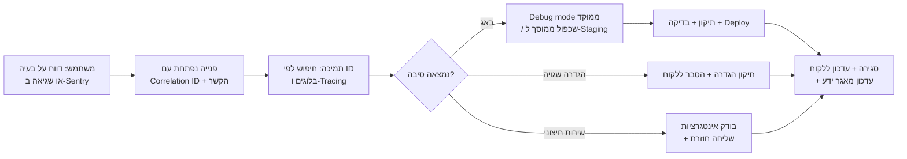

# 14. מודול Debugging ותמיכה טכנית

## 14.1 מטרה

לאתר ולפתור תקלות במערכת **מהר**, בלי לפגוע בפרטיות ובלי להשפיע על לקוחות אחרים. המודול משרת שלושה קהלים:
- **מפתחים**: איתור באגים.
- **צוות התמיכה שלך**: מענה לפניות לקוחות.
- **מנהלי הלקוח**: אבחון בעצמם של בעיות בהגדרות, באינטגרציות או ב-Gateways.

## 14.2 עקרונות

- **מזהה בקשה (Correlation ID)** לכל בקשה. הוא עובר בין ה-Frontend, ה-API, ה-Workers, התורים, ה-Webhooks וה-Gateway, ומוצג למשתמש בהודעת שגיאה, למשל "קוד תקלה: 7F3A-91C2". עם המזהה הזה התמיכה מוצאת את כל השרשרת בשניות.
- **Tracing מבוזר** (OpenTelemetry) שעוקב אחרי כל בקשה: אילו שאילתות SQL רצו ומה היה זמנן, אילו קריאות יצאו לשירותים חיצוניים, ואילו משימות רקע הופעלו.
- **ללא מידע אישי בכלי הדיבאג**: מיסוך אוטומטי של טלפונים, מיילים, ת"ז, חשבונות בנק וטוקנים. ראה [מסמך 15](15-logging-analytics.md#153-מיסוך-מידע-רגיש).
- **כל גישה של צוות לנתוני לקוח מתועדת** ומוגבלת בזמן.

## 14.3 רכיבים

| רכיב | תיאור | שלב |
|------|--------|-----|
| **מעקב שגיאות** | Sentry (בענן או בהתקנה עצמית): שגיאות Frontend ו-Backend, Stack trace, גרסה, Tenant, דפדפן, קיבוץ שגיאות זהות, והתראה על שגיאה חדשה או על עלייה בכמות | MVP |
| **כפתור "דווח על בעיה"** | בכל מסך. אוסף אוטומטית את המסך, ה-Correlation ID האחרון, הגרסה, הדפדפן, 50 פעולות אחרונות (ללא תוכן רגיש) ושגיאות קונסול, ופותח פנייה בתמיכה | MVP |
| **Debug mode ממוקד** | העלאת רמת הלוג ל-DEBUG לTenant, משתמש או נקודת API מסוימים, לזמן מוגבל (עד שעתיים), עם חזרה אוטומטית למצב הרגיל. בלי Deploy | MVP |
| **כניסה לחשבון בשם משתמש (Impersonation)** | התמיכה רואה את המסך כפי שהמשתמש רואה אותו. מצב **קריאה בלבד** כברירת מחדל. נדרשים אישור הלקוח או מספר פנייה, וזמן מוגבל. מוצג באנר בולט, והכול מתועד ביומן ונשלח בהודעה ללקוח | P2 |
| **הקלטת סשן (Session Replay)** | רק בהסכמת המשתמש ולזמן מוגבל, עם מיסוך מלא של כל שדות הקלט והטקסט. כלי בהתקנה עצמית, כמו OpenReplay או rrweb | P3 |
| **בודק משימות רקע (Queue Inspector)** | צפייה במשימות BullMQ: ממתינות, נכשלו, ניסיונות חוזרים. אפשר להריץ שוב משימה שנכשלה, למשל SMS שלא נשלח או PDF שלא הופק, ולראות את סיבת הכשל | MVP |
| **בודק Webhooks ואינטגרציות** | כל קריאה יוצאת ונכנסת (סולק, SMS, חשבוניות) נשמרת עם הבקשה, התשובה (ממוסכת), הסטטוס וזמן התגובה. אפשר לשלוח שוב Webhook שנכשל | MVP |
| **סימולטור SLA וחוקים** | "למה התקלה הזו הסלימה?": המערכת מציגה את מדיניות ה-SLA, לוח החגים וההשהיות, ואת החישוב שהוביל לתאריך היעד. אותו דבר לחוקי התראה בבניין חכם | P2 |
| **בודק הרשאות** | "למה משתמש X לא רואה את מסמך Y?": מציג אילו תפקידים, היקפים ומדיניות הובילו להחלטה | P2 |
| **בודק הגדרות** | מציג את הערך בפועל של כל הגדרה ומאיזו רמה הוא בא: פלטפורמה, Tenant או בניין (מסמך 6) | P2 |
| **אבחון Gateway מרחוק** | מצב החיבור, עוצמת אות סלולרי, CPU ודיסק, גודל החיץ המקומי, לוגים אחרונים, בדיקת תקשורת לנקודה בודדת (קריאה בלבד), וריסטארט מרחוק | P3 |
| **Feature flag override** | הפעלה או כיבוי של פיצ'ר למשתמש או Tenant בודד לצורך בדיקה | MVP |
| **עמוד בריאות מערכת** | `/health` ו-`/ready` לכל שירות, ולוח פנימי שמציג DB, Redis, Storage, תורים, שירותים חיצוניים, השהיית שכפול ותעודות שעומדות לפוג | MVP |
| **שכפול סביבה לבדיקה** | ייצוא Tenant בודד **עם מיסוך מלא** לסביבת Staging, כדי לשחזר באג על נתונים אמיתיים בלי מידע אישי | P2 |
| **בדיקות סינתטיות** | תרחישים אוטומטיים שרצים כל 5 דקות בסביבת הייצור על Tenant דמה: כניסה, פתיחת תקלה, תשלום בסביבת בדיקה של הסולק. התראה כשתרחיש נכשל | P2 |
| **השוואת גרסאות** | איזו גרסה רצה אצל כל Tenant, כולל פריסות ייעודיות ו-On-Prem, ומה השתנה בה (Changelog) | P2 |

## 14.4 תהליך טיפול בתקלה טכנית

## 14.5 עמידה בפרטיות

- גישה לכלי הדיבאג רק לצוות מורשה, עם 2FA ו-VPN או Zero-Trust.
- אין גישה ישירה לבסיס הנתונים של הייצור. כל שאילתה עוברת דרך כלי שמתעד ומגביל, ושאילתות נתונים מחייבות אישור.
- נתוני דיבאג נשמרים לזמן קצר: הקלטות סשן 14 יום, נתוני Debug mode 7 ימים.
- בפריסות On-Prem, הכלים רצים אצל הלקוח, וגישת התמיכה מתאפשרת רק בהזמנתו.
