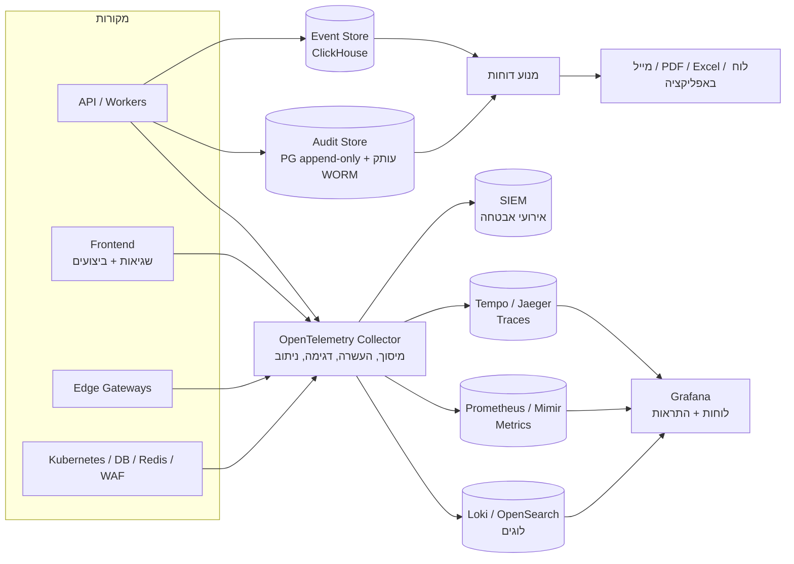

# 15. מודול איסוף וניתוח לוגים ודוחות תקופתיים

## 15.1 סוגי לוגים

| סוג | מה נרשם | מי צורך | שמירה (ברירת מחדל) |
|-----|---------|---------|--------------------|
| **לוג אפליקציה** | שגיאות, אזהרות, אירועי מערכת, ביצועים | מפתחים, תפעול | 30 יום חם, 90 יום ארכיון |
| **לוג גישה (Access)** | כל בקשת HTTP: נתיב, סטטוס, זמן, משתמש, Tenant, IP | תפעול, אבטחה | 90 יום |
| **יומן ביקורת (Audit)** | פעולות עסקיות רגישות: שינוי תשלום, הרשאה, מחיקה, ייצוא, צפייה בפרטי קשר | לקוח, רגולציה, משפטי | **7 שנים**, בלתי ניתן לשינוי |
| **לוג אבטחה** | כניסות, כשלי אימות, שינוי הרשאות, חסימות WAF, התראות זיהוי | אבטחה, SIEM | שנה לפחות |
| **לוג אינטגרציות** | קריאות לסולק, SMS, מייל וחשבוניות, עם סטטוס | תמיכה | 90 יום |
| **לוג הודעות** | כל הודעה שנשלחה: למי, באיזה ערוץ, סטטוס מסירה ועלות | לקוח, תמיכה | שנתיים |
| **לוג IoT** | חיבור וניתוק Gateways, פקודות, התראות | תפעול, לקוח | שנה (פקודות: 7 שנים) |
| **אירועים עסקיים** | אירועי מוצר כמו `ticket.created` ו-`payment.received` | דוחות, BI, סטטיסטיקה | ללא הגבלה (מצטבר) |
| **Metrics** | מספרים לאורך זמן: זמני תגובה, שגיאות, תורים, CPU | תפעול | 15 יום ברזולוציה מלאה, שנה מצטבר |
| **Traces** | מסלול בקשה מלא בין רכיבים | מפתחים | 7 ימים (דגימה) |

## 15.2 ארכיטקטורת איסוף

- **לוגים מובנים (JSON)**. בכל שורה: `timestamp`, `level`, `service`, `version`, `tenant_id`, `building_id`, `user_id` (מזהה בלבד), `correlation_id`, `trace_id` והודעה.
- **אחידות**: ספריית לוגים משותפת (pino) עם סכמה קבועה, כך שאפשר לחפש ולסנן בכל השירותים באותו אופן.
- **Grafana** כממשק אחד ל-Metrics, ללוגים ול-Traces, עם מעבר ישיר מגרף לשורת לוג ומשם ל-Trace.
- **On-Prem**: אותה ערימה רצה אצל הלקוח. אפשר להעביר Metrics מצטברים (בלי לוגים) למוקד שלך, בהסכמת הלקוח.

## 15.3 מיסוך מידע רגיש

- מיסוך אוטומטי ב-Collector ובספריית הלוגים: טלפון, מייל, ת"ז, כרטיס אשראי, חשבון בנק, טוקנים, סיסמאות ו-OTP.
- רשימת שדות אסורים בכל סכמה. שדה חדש עם שם חשוד מכשיל את ה-Build.
- גוף בקשות ותשובות **לא נרשם** כברירת מחדל. הוא נרשם רק ב-Debug mode ממוקד, ממוסך ולזמן מוגבל (מסמך 14).
- יומן הביקורת שומר מזהים ולא ערכים. למשל "שונה מספר הטלפון של דייר 123", בלי הערך עצמו, או עם ערך מוצפן כשיש צורך משפטי.

## 15.4 שלמות ושמירה

- **יומן ביקורת בלתי ניתן לשינוי**: טבלה שמאפשרת רק הוספה, עם שרשרת Hash (כל רשומה כוללת Hash של הקודמת) ועותק יומי לאחסון שלא ניתן לשנות (Object Lock). כך אפשר להוכיח שלא נעשו שינויים.
- **מדיניות שמירה** לכל סוג לוג, עם מחיקה אוטומטית בסיום התקופה (מזעור מידע).
- **Legal hold**: הקפאת מחיקה ל-Tenant או לאירוע מסוים בזמן חקירה או הליך משפטי.

## 15.5 ניתוח והתראות

**התראות תפעוליות (Grafana Alerting → PagerDuty / Telegram / מייל):**
- שיעור שגיאות 5xx מעל 1% במשך 5 דקות.
- זמן תגובה (p95) מעל 800ms.
- תור משימות שמתארך או משימות שנכשלות.
- כשל בבדיקה סינתטית.
- השהיית שכפול למסד הגיבוי מעל דקה.
- כשל בגיבוי או בבדיקת שחזור.
- תעודת TLS שפגה בעוד פחות מ-14 יום.
- Gateway שלא שידר יותר מ-10 דקות.
- עלות SMS יומית חריגה.

**ניתוח אבטחה (SIEM):** ניסיונות כניסה כושלים, Credential stuffing, גישה חריגה לנתונים (למשל משתמש שצפה ב-500 דיירים בשעה), ייצוא חריג, שינוי פרטי בנק, ופעילות מנהלים בשעות חריגות.

**זיהוי חריגות** [P3]: השוואה לדפוס הרגיל של כל Tenant, למשל ירידה חדה בכניסות או עלייה חריגה בתקלות.

## 15.6 דוחות תקופתיים

מנוע דוחות אחד שמשרת את כל הקהלים. כל דוח מוגדר עם תבנית, מקור נתונים, קהל, ערוץ ותזמון. כל משתמש יכול להירשם, לבטל, ולבחור יום ושעה.

### לקוחות (ועד, חברת ניהול)
| דוח | תדירות | תוכן |
|-----|---------|------|
| **סיכום יומי למנהל נכס** | יומי 07:00 | תקלות חדשות, תקלות שחורגות מה-SLA היום, עבודות מתוכננות, התראות מהבניין החכם, תשלומים שהתקבלו |
| **סיכום שבועי לוועד** | ראשון 08:00 | תקלות שנפתחו ונסגרו, עמידה ב-SLA, מצב גבייה, הוצאות קופה קטנה, אישורים שעומדים לפוג, RFQ פתוחים |
| **דוח חודשי לוועד** | 1 לחודש | דוח כספי (מסמך 12), תקלות לפי קטגוריה, ביצועי ספקים, תחזוקה מונעת שבוצעה מול המתוכנן, צריכת אנרגיה |
| **דוח רבעוני / שנתי** | רבעוני / שנתי | תקציב מול ביצוע, מגמות, ציון בטיחות, דוח לאסיפה הכללית |
| **פורטפוליו לחברת ניהול** | שבועי / חודשי | השוואת בניינים, KPI לכל מנהל נכס, ספקים מובילים וחלשים, רווחיות |
| **סקירת הרשאות** | רבעוני | מי מחזיק איזו הרשאה, עם אישור או הסרה |
| **יומן פעילות** | לפי דרישה | ייצוא יומן הביקורת לפי תקופה או משתמש |

### צוות הפלטפורמה (אתה)
| דוח | תדירות | תוכן |
|-----|---------|------|
| **בריאות תפעולית** | יומי | זמינות, שגיאות, זמני תגובה, אירועים, גיבויים ובדיקות שחזור, עלויות תשתית |
| **אבטחה** | יומי (תקציר), שבועי (מלא) | ניסיונות תקיפה שנחסמו, חשבונות שננעלו, חולשות חדשות בתלויות, אירועים פתוחים |
| **עסקי** | שבועי / חודשי | Tenants ובניינים פעילים, משתמשים פעילים יומיים וחודשיים, אימוץ פיצ'רים, נטישה, הכנסות, עלות SMS ו-WhatsApp |
| **תמיכה** | שבועי | פניות, זמן מענה, נושאים חוזרים, שגיאות חדשות לפי גרסה |
| **IoT** | שבועי | Gateways מנותקים, איכות נתונים, התראות שווא |

### פורמטים וערוצים
- לוח בקרה באפליקציה, PDF ממותג (מסמך 6), Excel, מייל עם תקציר ולחצן "לדוח המלא", ו-WhatsApp לתקציר קצר.
- **דוחות מותאמים** [P2]: בונה דוחות פשוט (בחירת מדדים, פילוחים ותקופה), עם שמירה ותזמון.

## 15.7 מודל נתונים (תוספת)

| ישות | שדות עיקריים |
|------|---------------|
| **ReportDefinition** | key, audience (tenant/platform), template, data_source, params_schema |
| **ReportSubscription** | user_id / role, report_key, scope, schedule (cron), channels[], format, locale, active |
| **ReportRun** | subscription_id, period, status, output_doc_id, sent_at, error |
| **RetentionPolicy** | log_type, tenant_id?, hot_days, archive_days, legal_hold |
| **AlertRule** (תפעול) | name, query, threshold, duration, severity, route |
