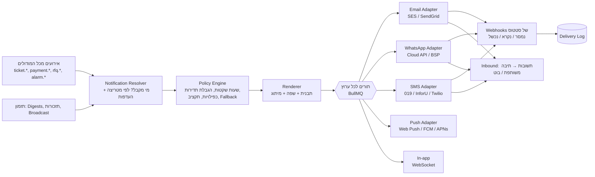

# 17. מודול תקשורת והודעות: ערוצים, קבוצות, תדירות

## 17.1 מטרה

מנוע אחד שאחראי על **כל** הודעה שיוצאת מהמערכת: מייל, WhatsApp, SMS, Push, הודעה בתוך האפליקציה, ובהמשך גם שיחה קולית. המנוע מאפשר לכל לקוח להגדיר **מה נשלח, למי, באיזה ערוץ, מתי ובאיזו תדירות**, בלי לכתוב קוד.

שלושה סוגי הודעות:

| סוג | דוגמה | מי יוזם |
|-----|-------|---------|
| **אוטומטית (אירוע)** | "התקלה שלך שובצה לטכנאי", "התקבל תשלום", "אישור כיבוי אש פג בעוד 14 יום" | המערכת, בעקבות אירוע |
| **תקופתית (Digest / דוח)** | סיכום שבועי לוועד, תזכורת חוב בכל 1 לחודש, דוח יומי למנהל נכס | המערכת, לפי תזמון |
| **יזומה (Broadcast)** | "הפסקת מים ביום שלישי 10:00–14:00", הזמנה לאסיפה כללית | ועד, חברת ניהול |

## 17.2 קבוצות יעד (Audiences)

**קבוצות קבועות** (מוגדרות מראש, מתעדכנות אוטומטית):
- כל הדיירים, בעלי דירות בלבד, שוכרים בלבד.
- חברי ועד, גזבר, מנהל נכס, אב בית, טכנאים.
- נציגי חברות ועובדים (במשרדים).
- ספקים פעילים, וספקים לפי תחום ("כל החשמלאים המאושרים").
- מבקרים, רואה חשבון.

**קבוצות דינמיות (לפי כלל)**: נבנות מסינון, ומתעדכנות אוטומטית בזמן השליחה:
- לפי מיקום: כניסה B, קומות 5–10, דירות בטור 3 (למשל להודעה על נזילה בקו מים), בעלי חניה בחניון תחתון.
- לפי מצב כספי: חוב מעל 60 יום, חוב מעל ₪1,000, לא הצטרפו להוראת קבע.
- לפי פעילות: פתחו תקלה בנושא מעליות ב-30 הימים האחרונים, טרם הצביעו בסקר.
- לפי מאפיין: דיירים עם צרכים מיוחדים (בהסכמתם), דוברי ערבית או רוסית, ותיקים או חדשים.
- **שילוב תנאים**: וגם / או / לא.

**קבוצות ידניות**: רשימה שנבחרת ידנית, למשל "ועדת גינון".

ברמת חברת ניהול אפשר להגדיר קבוצה **חוצת בניינים**, למשל "כל הגזברים בכל הבניינים שלנו".

## 17.3 ערוצים

| ערוץ | מתאים ל | הערות טכניות ועלות |
|------|---------|----------------------|
| **הודעה באפליקציה** (In-app) | הכול. תמיד נשמרת כהיסטוריה | חינם. מרכז הודעות עם סימון נקרא / לא נקרא |
| **Push** (Web / מובייל) | עדכונים מהירים | חינם. דורש הרשאה מהמשתמש בדפדפן או באפליקציה |
| **מייל** | דוחות, מסמכים, קבלות, הודעות ארוכות | זול. דומיין שליחה מאומת לכל לקוח (SPF/DKIM/DMARC), טיפול בהחזרות, קישור הסרה |
| **WhatsApp** | הערוץ עם הקריאה הגבוהה ביותר בישראל | WhatsApp Business Cloud API, ישירות מול Meta או דרך ספק מורשה (BSP). **הודעה יזומה מחייבת תבנית שאושרה מראש ע"י Meta**. התשלום הוא לכל הודעה לפי קטגוריה (Utility, Marketing, Authentication). אחרי שהדייר עונה נפתח חלון של 24 שעות לשיחה חופשית |
| **SMS** | גיבוי, קודי כניסה, מי שאין לו WhatsApp | בעברית כל 70 תווים הם הודעה נפרדת לחיוב. שם שולח (Sender ID) לכל לקוח |
| **שיחה קולית אוטומטית** [P3] | חירום (חומרה S1), דיירים מבוגרים | הקראת הודעה (TTS) בעברית עם אישור קבלה בלחיצת מקש |
| **Webhook / Slack / Teams** [P2] | חברות ניהול ומשרדים | חיבור לכלים הפנימיים שלהם |

### שרשרת גיבוי (Fallback)
אפשר להגדיר לכל הודעה סדר ערוצים, למשל:
```
WhatsApp → (לא נמסר תוך 10 דק') → SMS → (נכשל) → מייל
```
או **שליחה מקבילה** בכל הערוצים, למשל בחירום.

## 17.4 מטריצת הגדרות: הלב של המודול

ממשק בצורת טבלה, שבו **שורה = סוג הודעה** ו**עמודה = קבוצה**. בכל תא מגדירים: ערוצים, תזמון, תדירות ותבנית.

| סוג הודעה ↓ / קבוצה → | דיירים | ועד | מנהל נכס | ספקים |
|------------------------|--------|-----|----------|-------|
| תקלה חדשה נפתחה | — | Push, מיידי | Push + WhatsApp, מיידי | — |
| תקלה שלי עודכנה | WhatsApp, מיידי | — | — | — |
| תקלה חרגה מה-SLA | — | WhatsApp, מיידי | WhatsApp + SMS, מיידי | WhatsApp |
| תקלה S1 (חירום) | בניין שלם: כל הערוצים | כל הערוצים + שיחה | כל הערוצים + שיחה | כל הערוצים |
| תשלום התקבל | מייל + קבלה | — | — | — |
| תזכורת חוב | WhatsApp ב-1 לחודש, ואז מייל אחרי 7 ימים | סיכום שבועי | — | — |
| אישור עומד לפוג | — | מייל, 30/14/7 ימים לפני | מייל + Push | הספק הרלוונטי: מייל |
| הודעת ועד (Broadcast) | לפי בחירה בזמן השליחה | — | — | — |
| סיכום שבועי | — | מייל, ראשון 08:00 | מייל, ראשון 07:00 | — |
| RFQ חדש בתחום שלי | — | — | — | WhatsApp + מייל |

### מה מגדירים בכל תא
- **ערוצים**: אחד או יותר, כולל סדר הגיבוי.
- **תזמון**:
  - **מיידי**.
  - **מאוחד (Digest)**: מרכז כמה אירועים להודעה אחת, כל שעה, פעם ביום בשעה מסוימת, או פעם בשבוע.
  - **מושהה**: למשל רק אם התקלה עדיין פתוחה אחרי שעתיים.
  - **מתוזמן**: תאריך ושעה, או חזרה קבועה כמו "כל 1 לחודש ב-09:00".
- **שעות שקטות**: לא שולחים בין 22:00 ל-07:00 ובשבת וחג (לוח חגים ישראלי). הודעה שנוצרה בזמן הזה נשלחת בתום השעות השקטות. **חירום עוקף את השעות השקטות.**
- **הגבלת תדירות**: לא יותר מ-X הודעות לאדם ביום בערוץ מסוים. מעבר לזה ההודעות מתאחדות להודעת סיכום.
- **מניעת כפילויות**: אותו אירוע לא נשלח פעמיים לאותו אדם בערוצים שונים, אלא אם הוגדר כך. אם הנמען כבר קרא את ההודעה באפליקציה, ה-SMS מבוטל.
- **תבנית**: לפי שפה וערוץ.

### היררכיית הגדרות וירושה
```
ברירת מחדל של הפלטפורמה → חברת ניהול → בניין → קבוצה → העדפת המשתמש
```
- הפלטפורמה מגיעה עם **ערכת ברירות מחדל** מומלצת, כך שלקוח חדש לא צריך להגדיר דבר.
- חברת ניהול יכולה **לנעול** הגדרה, כך שבניין לא יוכל לשנות אותה.

## 17.5 העדפות המשתמש

כל משתמש יכול, **בתוך הגבולות שהלקוח קבע**:
- לבחור ערוץ מועדף לכל קטגוריה: תקלות, כספים, הודעות ועד, קהילה.
- לבחור תדירות (מיידי או סיכום יומי).
- להגדיר שעות שקטות אישיות.
- לבחור שפה.
- להסיר את עצמו מקטגוריות לא חיוניות.

**הודעות שאי אפשר לבטל**: חירום ובטיחות, הודעות משפטיות (התראת חוב לפני הליכים, זימון לאסיפה כללית), וקודי כניסה. המשתמש רשאי לבחור את הערוץ, אבל לא לבטל את ההודעה.

## 17.6 תבניות

- עורך תבניות לכל ערוץ, עם **משתנים**: `{{resident.first_name}}`, `{{building.name}}`, `{{ticket.number}}`, `{{ticket.due_at}}`, `{{balance.amount}}`, `{{payment.link}}`.
- **תנאים**: `{{#if balance > 0}}...{{/if}}`.
- **שפות**: עברית, אנגלית, ערבית ורוסית. ההודעה נשלחת לכל נמען בשפה שלו.
- **מיתוג**: לוגו וצבעים במייל (מסמך 6).
- **תצוגה מקדימה** עם נתוני דייר לדוגמה, ו**שליחת בדיקה** לעצמי.
- **תבניות WhatsApp**: המערכת מגישה את התבנית לאישור Meta ומציגה את סטטוס האישור. הודעה יזומה ב-WhatsApp אפשר לשלוח רק לפי תבנית שאושרה.
- **ספריית תבניות** מוכנה בעברית: הפסקת מים, ניקיון חדר מדרגות, טיפול מתוכנן במעלית, זימון לאסיפה, תזכורת חוב בכמה רמות טון ועוד.
- **קישורים חכמים** בתוך ההודעה: "לתשלום", "לצפייה בתקלה" או "לאישור". הקישור קצר ומאובטח, ומכניס את המשתמש בלי סיסמה ובהרשאה מוגבלת.
- [P3] עוזר AI לניסוח הודעה, שמציע ניסוח לפי מטרה וטון.

## 17.7 הודעות יזומות (Broadcast) מהוועד וחברת הניהול

1. בחירת קבוצה (קבועה, דינמית או ידנית). המערכת מציגה כמה נמענים יקבלו את ההודעה ובאיזה ערוץ.
2. בחירת תבנית או כתיבה חופשית, וצירוף קובץ או תמונה.
3. בחירת ערוצים, ו**הערכת עלות** (מספר הודעות SMS ו-WhatsApp).
4. שליחה מיידית, מתוזמנת או חוזרת.
5. **אישור** לפי הצורך: הודעה מעל X נמענים, או בעלות מעל ₪Y, דורשת אישור חבר ועד נוסף.
6. מעקב בזמן אמת: נשלח, נמסר, נקרא, נכשל.
7. **שליחה חוזרת אוטומטית** למי שלא קרא, בערוץ אחר.

**פרטיות**: הודעה נשלחת לכל נמען בנפרד. אף נמען לא רואה את המספרים או המיילים של האחרים (בניגוד לקבוצת WhatsApp רגילה).

## 17.8 תקשורת דו-כיוונית

- **תשובה להודעה** ב-WhatsApp, SMS או מייל נכנסת ל**תיבת הודעות משותפת** של הוועד או של חברת הניהול, ומשויכת אוטומטית לדייר ולנושא, למשל לתקלה.
- **כפתורים ב-WhatsApp**: "אשר הגעה לאסיפה", "התקלה תוקנה? כן / לא", "דרג את הטכנאי 1–5".
- [P2] **בוט WhatsApp**: הדייר כותב "יש נזילה בחניון" ומקבל שאלה לבחירת קטגוריה ובקשה לתמונה, ואז נפתחת תקלה. אפשר גם לבדוק יתרה ("מה היתרה שלי") ולהגיע לתשלום.
- **ניתוב**: שיחה פתוחה שהגיעה מחוץ לשעות הפעילות מקבלת תשובה אוטומטית, ושיחה דחופה מנותבת לכונן.

## 17.9 מעקב, דוחות ועלויות

- **סטטוס לכל הודעה**: נוצרה, בתור, נשלחה, נמסרה, נקראה, נלחץ קישור, נכשלה (עם סיבה), הוחזרה.
- **דוחות**:
  - אחוזי מסירה וקריאה לפי ערוץ וקבוצה.
  - הודעות שנכשלו, ונמענים עם פרטים שגויים (מספר לא תקין, מייל שחוזר).
  - **עלות לפי לקוח, בניין, ערוץ וחודש**.
- **ניהול תקציב**: תקרה חודשית לכל לקוח. כשמגיעים ל-80% נשלחת התראה. ב-100% ההודעות עוברות לערוצים חינמיים, חוץ מחירום.
- **חיוב**: עלות SMS ו-WhatsApp מעבר למכסה בחבילה מחויבת ללקוח (מסמך 9).
- **בריאות הנמענים**: מספרים ומיילים שנכשלו שוב ושוב מסומנים, והוועד מתבקש לעדכן אותם.

## 17.10 היבטים משפטיים

- **חוק התקשורת, סעיף 30א (חוק הספאם)**: הודעות שירות ומידע (תקלה, חוב, אסיפה) מותרות. **הודעה שיווקית**, למשל הצעה מספק, מחייבת הסכמה מפורשת וקישור הסרה. המערכת מסווגת כל תבנית כ"שירות" או "שיווק" ואוכפת את הכלל.
- **מדיניות WhatsApp**: הסכמה (Opt-in) לקבלת הודעות, נשמרת עם תאריך ומקור. שמירה על איכות כדי שהמספר לא ייחסם.
- **פרטיות**: שליחה אישית לכל נמען, תיעוד הסכמות, ו**התראות חוב לא נשלחות לקבוצה**.
- **ראיה משפטית**: הודעות משפטיות כמו זימון לאסיפה ומכתב התראה נשמרות עם אישור מסירה וחותמת זמן, ואפשר להפיק מהן PDF.

## 17.11 ארכיטקטורה



- **Outbox Pattern**: הודעה נוצרת באותה טרנזקציה עם האירוע, כך שאין אובדן הודעות.
- **מתאם (Adapter) לכל ספק**, מאחורי ממשק אחיד. **שני ספקי SMS** לפחות, עם מעבר אוטומטי בתקלה.
- **הגבלת קצב לכל ספק** (WhatsApp מגביל לפי דירוג המספר), ושליחה הדרגתית ב-Broadcast גדול.
- **Idempotency**: כל הודעה מקבלת מפתח ייחודי, וכך ניסיון חוזר לא יוצר כפילות.
- **מספר WhatsApp**: מספר משותף של הפלטפורמה בחבילה הבסיסית, או **מספר ייעודי עם שם ולוגו של חברת הניהול** בחבילת White-label.

## 17.12 מודל נתונים (תוספת)

| ישות | שדות עיקריים |
|------|---------------|
| **NotificationType** | key (`ticket.assigned`...), category (tickets/finance/governance/safety/marketing), class (service/marketing/legal/emergency), mandatory, default_channels |
| **Audience** | tenant_id, building_id?, name, kind (static/dynamic/manual), rule (JSON filter), member_ids[] (ידני) |
| **NotificationPolicy** | scope (platform/tenant/building), notification_type, audience_id, channels[], fallback_chain, timing (immediate/digest/delayed/scheduled), digest_schedule, delay_minutes, quiet_hours, frequency_cap, template_id, locked |
| **UserNotificationPreference** | user_id, category, channels[], frequency, quiet_hours, locale |
| **Template** | tenant_id?, channel, locale, notification_type?, subject, body, variables_schema, class, wa_template_name, wa_status (pending/approved/rejected) |
| **Broadcast** | building_id / tenant_id, audience_id, template_id / body, channels[], scheduled_at, recurrence (RRULE), approval_status, estimated_cost, created_by |
| **Message** | recipient_user_id / address, channel, template_id, payload, status, provider, provider_message_id, cost, sent_at, delivered_at, read_at, failed_reason, correlation_id, idempotency_key |
| **Consent** | person_id, channel, purpose (service/marketing), granted_at, source, revoked_at |
| **InboundMessage** | channel, from, body, attachments, matched_person_id, conversation_id, linked_ticket_id |
| **Conversation** | tenant_id, person_id, channel, status, assigned_to, last_message_at |
| **ChannelBudget** | tenant_id, channel, monthly_cap, spent, alert_threshold |

## 17.13 API

```
GET    /api/v1/notification-types
GET    /api/v1/audiences            POST /api/v1/audiences
POST   /api/v1/audiences/:id/preview         # כמה נמענים ובאילו ערוצים
GET    /api/v1/notification-policies?scope=  PUT /api/v1/notification-policies/:id
GET    /api/v1/templates            POST /api/v1/templates
POST   /api/v1/templates/:id/test-send
POST   /api/v1/templates/:id/submit-whatsapp
POST   /api/v1/broadcasts           POST /api/v1/broadcasts/:id/approve
GET    /api/v1/broadcasts/:id/stats
GET    /api/v1/me/notification-preferences   PUT /api/v1/me/notification-preferences
GET    /api/v1/me/notifications               # מרכז הודעות
GET    /api/v1/conversations                  # תיבה משותפת
POST   /api/v1/webhooks/messaging/:provider   # סטטוסים והודעות נכנסות
```

## 17.14 שלבים

| שלב | יכולות |
|-----|--------|
| **MVP** | הודעה באפליקציה, מייל ו-SMS. סוגי הודעות עיקריים עם ברירות מחדל. קבוצות קבועות. Broadcast בסיסי. תבניות בעברית. שעות שקטות ושבת. מעקב מסירה. העדפות משתמש בסיסיות |
| **שלב 2** | **WhatsApp** (תבניות, כפתורים, תשובות), **מטריצת הגדרות מלאה**, קבוצות דינמיות, הודעות מאוחדות (Digest), שרשרת גיבוי, הגבלת תדירות, תקציב ועלויות, תיבה משותפת, שליחה חוזרת למי שלא קרא, Push, בוט WhatsApp בסיסי |
| **שלב 3** | שיחה קולית לחירום, Slack ו-Teams, עוזר AI לניסוח, מספר WhatsApp ממותג ללקוח, ניתוח שעות השליחה המיטביות |
