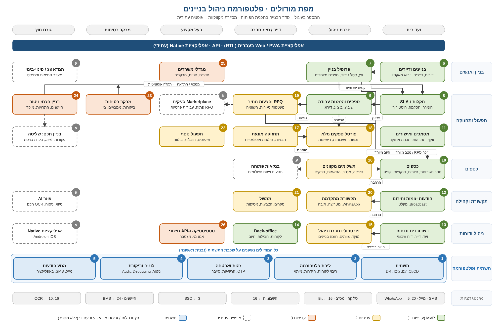

# 19. מפת מודולים וסדר בנייה

> המספר בעיגול הוא סדר הבנייה בתכנית הפיתוח. מסגרת מקווקוות היא אופציה עתידית (מסומנת "ע", ללא מספר).
> המקור לתמונה: `tools/diagram/modules.py`. ליצירה מחדש: `python3 tools/diagram/modules.py docs/img/module-map.svg`.

## סדר הבנייה

| # | מודול | שלב | מסמך |
|---|-------|-----|------|
| 1 | תשתית: CI/CD, ענן, גיבוי, DR | תשתיות | [05](05-deployment-backup.md) |
| 2 | ליבת פלטפורמה: ריבוי לקוחות, הגדרות, מיתוג, קבצים, אירועים | תשתיות | [03](03-architecture.md), [06](06-customization.md) |
| 3 | זהות, הרשאות ואבטחת סייבר | תשתיות | [07](07-security-privacy.md), [13](13-cyber-security-auth.md) |
| 4 | לוגים, ניטור, יומן ביקורת ו-Debugging | תשתיות | [14](14-debugging.md), [15](15-logging-analytics.md) |
| 5 | מנוע הודעות: מייל, SMS, באפליקציה | תשתיות | [17](17-notifications.md) |
| 6 | בניינים ודיירים | MVP | [01](01-requirements.md) |
| 7 | פרופיל בניין: עץ, קטלוג ציוד, מצבים מיוחדים | MVP | [18](18-building-profile.md) |
| 8 | תקלות ו-SLA | MVP | [02](02-tickets-sla.md) |
| 9 | ספקים והזמנות עבודה (בסיס) | MVP | [01](01-requirements.md) |
| 10 | כספים: ספר חשבונות, חיובים, סנקציות, קופה קטנה | MVP | [12](12-payments.md) |
| 11 | מסמכים ואישורים | MVP | [01](01-requirements.md) |
| 12 | הודעות יזומות וחירום | MVP | [17](17-notifications.md), [16](16-gap-analysis.md) |
| 13 | דשבורדים ודוחות | MVP | [15](15-logging-analytics.md) |
| 14 | Back-office של הפלטפורמה | MVP | [16](16-gap-analysis.md) |
| 15 | פורטפוליו חברת ניהול | עדיפות 2 | [01](01-requirements.md) |
| 16 | תשלומים מקוונים, התאמות ותשלום לספקים | עדיפות 2 | [12](12-payments.md) |
| 17 | תחזוקה מונעת מלאה | עדיפות 2 | [01](01-requirements.md) |
| 18 | פורטל ספקים מלא | עדיפות 2 | [01](01-requirements.md) |
| 19 | RFQ והצעות מחיר | עדיפות 2 | [10](10-rfq.md) |
| 20 | תקשורת מתקדמת: WhatsApp, מטריצה, תיבה משותפת | עדיפות 2 | [17](17-notifications.md) |
| 21 | ממשל: סקרים, הצבעות, אסיפות | עדיפות 2 | [01](01-requirements.md) |
| 22 | תפעול נוסף: שיפוצים, הובלות, ביטוח | עדיפות 2 | [16](16-gap-analysis.md) |
| 23 | מבקר בטיחות | עדיפות 3 | [01](01-requirements.md) |
| 24 | בניין חכם: ניטור ודיווח | עדיפות 3 | [11](11-smart-building.md) |
| 25 | מגדלי משרדים: חדרים, חניות, מבקרים | עדיפות 3 | [01](01-requirements.md) |
| 26 | סטטיסטיקה ו-API חיצוני | עדיפות 3 | [01](01-requirements.md) |
| ע | אופציות עתידיות: שליטה בבניין חכם, Marketplace, עוזר AI, תמ"א 38, אפליקציות Native, בנקאות פתוחה | לפי החלטה | [16](16-gap-analysis.md) |

## קשרים מרכזיים

- **7 ← 8**: פרופיל הבניין קובע קטגוריות תקלה וציוד.
- **23, 24 ← 8**: ממצא ביקורת או התראת חיישן פותחים תקלה אוטומטית.
- **8 ← 9 ← 19**: תקלה משובצת לספק, ומספק יוצאת בקשה להצעות מחיר.
- **7, 19 ← 10**: מצב מיוחד או זוכה ב-RFQ יוצרים חיוב מיוחד.
- **17 ← 18**: תחזוקה מונעת יוצרת הזמנות עבודה בפורטל הספקים.
- המודולים 15, 16, 18 ו-20 מרחיבים את 13, 10, 9 ו-12, בהתאמה.
- **כל המודולים** נשענים על שכבת התשתית (1–5).
