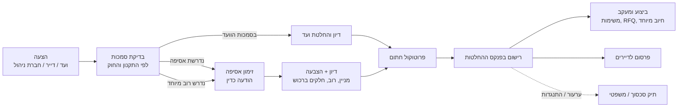

# 22. מודול משפטי וקבלת החלטות

> המודול הוא כלי ניהול ותיעוד, ואינו ייעוץ משפטי. נוהלי העבודה ייקבעו יחד עם עורך דין (ראה גם [מסמך 21](21-legal-regulatory.md)).

## 22.1 מטרה

לנהל בצורה מסודרת, שקופה ומתועדת את כל מה שיש לו השלכה משפטית בבניין:
1. **קבלת החלטות**: מהצעה ועד ביצוע, עם הוכחה שההחלטה התקבלה כדין.
2. **תיקים משפטיים**: תביעות נגד הבניין או הוועד, תביעות של הבניין נגד אחרים, וגבייה משפטית.
3. **סכסוכים פנימיים**: בין שכנים, ובין דייר לוועד.
4. **עבודה עם עורך דין**: גישה מבוקרת לתיק, מסמכים, מועדים ועלויות.

## 22.2 תהליך קבלת החלטות

- **בדיקת סמכות אוטומטית**: לפי פרמטרי התקנון (מסמך 21) המערכת קובעת אם הוועד רשאי להחליט לבד, או שנדרשת אסיפה רגילה או רוב מיוחד. לדוגמה: הוצאה מעל ₪X, שינוי ברכוש המשותף או שינוי תקנון.
- **זימון כדין**: הודעה לכל הבעלים בפרק הזמן הנדרש, בערוצים מתועדים עם אישור מסירה (מסמך 17), וסדר יום.
- **הצבעה**: באסיפה (נוכחות וייפוי כוח) או דיגיטלית, אם התקנון מתיר. ספירה לפי ראש או לפי חלקים ברכוש המשותף, ובדיקת מניין ורוב.
- **פרוטוקול**: תבנית, חתימה דיגיטלית, נוכחים, תוצאות הצבעה ונספחים.
- **פנקס החלטות**: רשימה רציפה וקבועה של כל ההחלטות, עם תאריך, סוג, בסיס, תוצאה ומסמכים. החלטות לא נמחקות, אלא מבוטלות או מתוקנות בהחלטה חדשה.
- **מעקב ביצוע**: לכל החלטה יש משימות, אחראי ומועד. ההחלטה מקושרת ל-RFQ, לחיוב מיוחד או למצב מיוחד. המערכת מתריעה על החלטה שלא בוצעה.
- **התנגדות**: דייר יכול להגיש התנגדות מתועדת, שעלולה להפוך לתיק סכסוך.

## 22.3 תיקים משפטיים

### סוגי תיקים
| כיוון | דוגמאות |
|-------|---------|
| **נגד הבניין / הוועד** | נפילה ברכוש המשותף (נזק גוף), נזק לרכב בחניון, נזקי מים מהרכוש המשותף לדירה, דייר שתובע את הוועד (החלטה, חשבונות), ספק שתובע על אי-תשלום |
| **של הבניין נגד אחרים** | ליקויי בנייה מול הקבלן (תקופת בדק), ספק שלא ביצע או גרם נזק, חברת ביטוח שדחתה תביעה, נזק מבניין שכן או מעבודות עירייה, דייר שפלש לרכוש המשותף |
| **גבייה** | דייר שלא משלם: מכתב התראה, תביעה למפקח על רישום מקרקעין או לבית משפט, הוצאה לפועל (מחובר למדרג הגבייה במסמך 12) |
| **סכסוכים פנימיים** | רעש, נזילה בין דירות, חניה, שימוש ברכוש המשותף: גישור פנימי לפני הליך |
| **רגולטורי** | צו או התראה מעירייה, כבאות או משרד העבודה (למשל השבתת מעלית) |

### תוכן התיק
- **צדדים**: תובע, נתבע, עורכי דין ומבטח.
- **ערכאה**: מפקח על רישום מקרקעין, בית משפט לתביעות קטנות, שלום, מחוזי, הוצאה לפועל, גישור או בוררות. מספר תיק.
- **סטטוס**: טרום הליך, מכתב דרישה, הליך פתוח, גישור, פסק דין, ערעור, ביצוע, סגור.
- **מועדים**: הגשת כתבי טענות, דיונים, התיישנות. התראות למי שאחראי.
- **ראיות מהמערכת** בלחיצה: תקלות ותמונות לפני ואחרי, יומן ביקורת, הודעות שנשלחו עם אישור מסירה, פרוטוקולים, החלטות, חשבונות, ביקורות בטיחות, נתוני חיישנים. כל אלה מצורפים כ"ערכת ראיות" עם חותמת זמן.
- **הקפאת מחיקה (Legal Hold)**: נתונים שקשורים לתיק לא נמחקים לפי מדיניות השמירה הרגילה (מסמך 15).
- **ביטוח**: הודעה למבטח (צד ג', מבנה) במועד, ומעקב אחרי כיסוי והשתתפות עצמית. מחובר למודול הביטוח.
- **כספים**: שכר טרחה, אגרות, מומחים, הוצאות ופיצויים. ההוצאות נרשמות בספר החשבונות (קרן, תקציב משפטי), ופיצוי שהתקבל נרשם כהכנסה.
- **סיכום וחשיפה**: סכום התביעה, הערכת סיכון (ממולאת ע"י עורך הדין) והפרשה לתקציב.

### חיסיון ושקיפות
- **חיסיון עורך דין-לקוח**: התכתבות עם עורך הדין וחוות דעת מסומנות כחסויות, ונגישות רק לוועד ולעורך הדין.
- **ניגוד עניינים**: חבר ועד שהוא צד לתיק (למשל הדייר התובע) **מוחרג אוטומטית** מגישה לתיק ומהצבעה עליו.
- **דיווח לדיירים**: עדכון כללי ולא חסוי (קיום התיק, סטטוס, עלויות), לפי החלטת הוועד ובכפוף לייעוץ.

## 22.4 עבודה עם עורך דין

- **תפקיד "עורך דין"** חיצוני, עם גישה מוגבלת לתיק או לתיקים מסוימים, לזמן מוגבל ועם 2FA.
- **מה עורך הדין רואה ועושה**: מסמכי התיק, ערכת ראיות, מועדים, העלאת כתבי טענות, עדכון סטטוס, הערכת סיכון, דיווח שעות וחשבונות.
- **בחירת עורך דין**:
  - עורך דין קבוע של הוועד או של חברת הניהול.
  - בקשת הצעות מחיר מעורכי דין דרך מודול ה-RFQ (שכר טרחה קבוע, שעתי או באחוזים).
  - [עתידי] עורכי דין מומלצים מרשת הבניינים (מסמך 20), עם דירוג מתיקים מאומתים.
- **הסכם שכר טרחה**: נשמר בתיק, ובמעקב מול חשבונות.
- **ייפוי כוח מהוועד**: החלטת ועד או אסיפה לפתיחת הליך נשמרת בפנקס ההחלטות, וזה הבסיס לסמכות.

## 22.5 גישור וסכסוכים פנימיים

- **פנייה** של דייר נגד דייר או נגד הוועד: נושא, תיאור, ראיות.
- **שלבים**: הידברות בתיווך הוועד, גישור פנימי (חבר ועד ניטרלי או מגשר חיצוני), ורק אז הפניה להליך.
- **פרטיות**: הפנייה לא חשופה לשכנים, ורק הוועד או המגשר רואים אותה.
- **תבניות**: מכתבי פנייה, הסכם גישור וסיכום פגישה.

## 22.5.1 גורמים חיצוניים ליישוב מחלוקות

> שמות הגופים, סמכויותיהם, העלויות ודרכי הפנייה **מחייבים אימות**, ונשמרים כנתונים מתעדכנים ולא בקוד (עיקרון "חוק כנתונים", מסמך 21).

### סוגי גורמים
| סוג | דוגמאות (לאימות) | מתאים ל | אופי |
|-----|-------------------|---------|------|
| **ייעוץ, הדרכה וגישור לבתים משותפים** | **האגודה לתרבות הדיור**: מסייעת לנציגויות בייעוץ, הדרכה וגישור, לרוב בשיתוף רשויות מקומיות | מגורים | מסייע, לא מכריע |
| **גישור קהילתי** | מרכזי גישור ודיאלוג עירוניים או קהילתיים | מגורים, סכסוכי שכנים | מסייע, וולונטרי |
| **ערכאה מעין-שיפוטית** | **המפקח על רישום מקרקעין** (המפקח על הבתים המשותפים): סכסוכים בין בעלי דירות ובין דייר לנציגות בבית משותף רשום, כמו תשלום הוצאות, שימוש ברכוש המשותף ומימוש התקנון | מגורים, וגם משרדים אם הבניין רשום כבית משותף | מכריע |
| **בתי משפט** | תביעות קטנות, שלום, מחוזי | נזקים, חוזים, סכומים | מכריע |
| **בוררות וגישור מסחריים** | מוסדות בוררות וגישור ובוררים פרטיים, לפי סעיף בחוזה | **משרדים ומבנים שאינם למגורים** (חוזי שכירות וניהול) | לפי החוזה |
| **רשויות ופניות ציבור** | העירייה (מוקד 106, פיקוח, רישוי), הרשות להגנת הצרכן (מול ספקים), כבאות ומשרד העבודה (בטיחות) | מגורים ומשרדים | אכיפה ותלונה |
| **סיוע משפטי** | גורמי סיוע משפטי לזכאים | דיירים | מסייע |

### משרדים ומבנים שאינם למגורים
- **בניין רשום כבית משותף** (למשל מגדל משרדים מחולק לבעלים): חל אותו מסלול כמו במגורים, כולל המפקח.
- **בעלים יחיד ושוכרים**: היחסים חוזיים. **סעיף יישוב המחלוקות בחוזה השכירות או הניהול** נשמר כפרמטר עם מקור (בוררות, גישור או סמכות שיפוט), והמערכת מציעה את המסלול לפיו.
- **נציגות שוכרים** (אם קיימת) מקבלת תפקיד דומה לוועד, לצורך פניות משותפות לבעלים או לחברת הניהול.

### איך זה משולב במערכת
1. **מדרג הסלמה בתיק סכסוך** (22.5): הידברות ← הוועד ← גישור פנימי ← **גישור חיצוני** (האגודה, מרכז גישור) ← **ערכאה** (מפקח, בית משפט, בוררות). כל שלב מתועד עם תאריכים ותוצאה.
2. **"מסלול מומלץ"**: שאלון קצר (סוג הבניין, רשום כבית משותף?, סוג המחלוקת, סכום, הצדדים) שמציג את הגורמים הרלוונטיים, מה כל אחד עושה, עלות משוערת ואיך פונים. **הצגה בלבד, לא ייעוץ משפטי**, עם המלצה להתייעץ עם עורך דין.
3. **הכנת תיק לפנייה**: המערכת מרכזת את מה שבדרך כלל נדרש, לפי רשימה שמוגדרת לכל גוף. לדוגמה: תקנון, החלטות ופרוטוקולים, כרטסת חוב, התכתבויות עם אישורי מסירה, תמונות וחוות דעת. אלה נאספים ל-PDF מסודר עם חותמת זמן, מתוך ערכת הראיות.
4. **תבניות**: מכתב דרישה, בקשה לגישור, וטיוטת תביעה למפקח לפי מבנה הטופס הרלוונטי. התבניות מקבלות גרסה ונבדקות ע"י עורך דין.
5. **תפקיד "מגשר / יועץ חיצוני"**: גישה לתיק הסכסוך בלבד, לזמן מוגבל, עם **חיסיון גישור**. המידע מההליך לא עובר לתיק משפטי בלי הסכמה.
6. **מעקב אחרי הליך חיצוני**: הערכאה (מפקח או בית משפט), מספר תיק, דיונים, החלטה או פסק דין, ומעקב ביצוע. החלטת המפקח, למשל חיוב בתשלום, מתחברת לכספים ולמדרג הגבייה.
7. **ספריית גורמים**: טבלה מנוהלת של גופים לפי אזור ותחום, עם פרטי קשר, אתר, עלות, סוג (מסייע או מכריע) ותאריך בדיקה אחרון. מתעדכנת ע"י הפלטפורמה, והלקוח יכול להוסיף גורמים משלו (למשל מגשר קבוע).

### שותפויות אפשריות
- **האגודה לתרבות הדיור**: שותף טבעי, שמחזק גם את הפצת המערכת.
  - הפניית ועדים ליועצים ולמגשרים שלהם מתוך המערכת.
  - תכני הדרכה בספריית הידע (מסמך 20).
  - הדרכות לוועדים.
  - אפשרות לפעול כערוץ הפצה מול רשויות מקומיות שעובדות איתם.
- **מרכזי גישור עירוניים**: הפניה מתוך המערכת ותבנית פנייה.
- **משרדי עורכי דין מקרקעין**: עורכי דין מומלצים ברשת (עתידי).

**הערה**: אין כרגע הנחה שקיים ממשק דיגיטלי (API) לגופים האלה. החיבור הוא דרך הפניה, הכנת מסמכים ומעקב. אם יהיה ממשק בעתיד, הוא יתווסף כמתאם (Adapter).

## 22.6 דוחות והתראות

- **רשימת תיקים פתוחים** עם סיכום חשיפה כספית ועלויות.
- **מועדים קרובים**: 30 ו-7 ימים לפני, ויום לפני.
- **התיישנות**: התראה על תביעה פוטנציאלית שמתקרבת להתיישנות, למשל ליקויים בתום תקופת הבדק.
- **החלטות שלא בוצעו**.
- **דוח שנתי לאסיפה**: תיקים, תוצאות ועלויות.

## 22.7 מודל נתונים

| ישות | שדות עיקריים |
|------|---------------|
| **Proposal** | building_id, proposer_id, title, description, amount?, category, authority_check (committee/assembly/special_majority), status |
| **Meeting** | building_id, type (committee/general/special), scheduled_at, notice_sent_at, agenda (JSON), quorum_required, quorum_present, minutes_doc_id |
| **Vote** | meeting_id / proposal_id, method (in_person/digital/proxy), weighting (per_unit/per_share), options, results (JSON), majority_required, passed |
| **Decision** | building_id, number (רץ), date, title, basis (bylaws clause / law), vote_id?, status (active/amended/revoked), amends_id?, documents |
| **DecisionTask** | decision_id, title, owner_id, due_at, status, linked (rfq/charge_plan/state/case) |
| **Objection** | decision_id, person_id, text, status, case_id? |
| **LegalCase** | building_id, direction (against_building/by_building/collection/internal/regulatory), title, parties (JSON), forum, case_number, status, claim_amount, risk_assessment, insurer_notified_at, legal_hold, privileged |
| **CaseDeadline** | case_id, type (filing/hearing/limitation/other), due_at, owner_id, done_at |
| **CaseEvidence** | case_id, source_type (ticket/audit/message/doc/telemetry/ledger), source_id, captured_at, hash |
| **CaseCost** | case_id, type (fee/court/expert/settlement/award), amount, journal_entry_id |
| **LawyerEngagement** | case_id / tenant_id, lawyer_user_id, firm, fee_agreement_doc_id, fee_model, access_until |
| **Dispute** | building_id, complainant_id, respondent (person/committee), topic, status (open/dialogue/mediation/escalated/closed), mediator_id |
| **ResolutionBody** | key, name, type (advisory/mediation/quasi_judicial/court/arbitration/authority/legal_aid), building_types[], issue_types[], regions[], contact, url, cost_note, required_documents (JSON), source_id, reviewed_at, tenant_id? (גורם שהלקוח הוסיף) |
| **EscalationStep** | dispute_id / case_id, level (dialogue/committee/internal_mediation/external_mediation/forum), body_id?, started_at, ended_at, outcome |
| **ContractDisputeClause** | contract_id (שכירות/ניהול), mechanism (arbitration/mediation/court), forum, clause_ref |

## 22.8 שלבים

| שלב | יכולות |
|-----|--------|
| **שלב 2** | תהליך קבלת החלטות מלא (יחד עם מודול 21: בדיקת סמכות, זימון, הצבעה, פרוטוקול), פנקס החלטות, מעקב ביצוע, תיקים משפטיים בסיסיים, מועדים, ערכת ראיות, Legal Hold, תפקיד עורך דין |
| **שלב 3** | גישור וסכסוכים פנימיים, מדרג הסלמה וגורמים חיצוניים (ספריית גורמים, מסלול מומלץ, הכנת תיק לפנייה, תפקיד מגשר), סעיף מחלוקות בחוזי משרדים, עלויות וחשיפה בספר החשבונות, RFQ לעורכי דין, התיישנות ותקופות בדק |
| **עתידי** | עורכי דין מומלצים ברשת, ניסוח מסמכים בעזרת AI, הגשה מקוונת לערכאות (אם יהיה ממשק) |
