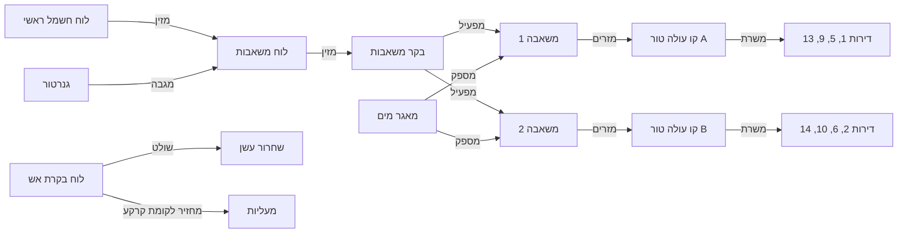

# 24. מערכות הבניין: מיפוי, קשרים, תקלות אופייניות ותחזוקה

## 24.1 מטרה

לתאר כל בניין כ**אוסף מערכות מחוברות**, ולא כרשימת ציוד מנותקת. לכל מערכת יש רכיבים, קשרים ביניהם ("מזין", "מפעיל", "שולט", "מגן") ואזורים שהיא משרתת (קומות, טורים, דירות). על בסיס המיפוי הזה המערכת יכולה:
- **לזהות מקור תקלה**: למשל, שלוש דירות באותו טור בלי מים חמים מצביעות על הצנרת המשותפת או על הדוד, ולא על שלוש תקלות נפרדות.
- **לזהות תקלות אופייניות** לכל סוג רכיב, לפי ספריית ידע.
- **להעריך השפעה**: אם המשאבה מושבתת, מי נפגע. ההודעה נשלחת רק למי שמושפע.
- **לשפר תחזוקה**: תחזוקה מונעת לפי סוג רכיב, זמן, שעות עבודה ומצב, ותכנון החלפה לפי גיל.
- **לשמור ידע בבניין**: תכניות, הוראות הפעלה ואחריות נשארות במערכת גם כשמחליפים ועד, חברת ניהול או אב בית.

## 24.2 קטלוג המערכות

| מערכת | רכיבים לדוגמה | בטיחות חיים |
|-------|----------------|:-----------:|
| **מים קרים** | חיבור עירוני ומונה ראשי, מאגר, משאבות ובקר, מסנן, מקטין לחץ, קווים עולים (טורים), ברזים ראשיים לקומה, מונים לדירות | |
| **מים חמים** | דוד מרכזי או משאבת חום, קולטים סולאריים, משאבת סחרור, צנרת, מערבל | |
| **טיהור מים** | מסננים, מערכת ריכוך, UV או כלור, בדיקות איכות | |
| **ביוב וניקוז** | קווים אנכיים, שוחות, משאבות ביוב וניקוז ובקר, מפרידי שומן, מרזבים, ניקוז חניון | |
| **חשמל** | חיבור חברת החשמל, לוח ראשי, לוחות משנה (קומה, מעליות, משאבות, חניון), הארקה, מונים, קבלים | |
| **גנרטור** | גנרטור, מיכל דלק, מפסק העברה (ATS), לוח חירום, הצרכנים המגובים | |
| **סולארית** | פאנלים, ממירים, מונה ייצור, חיבור לרשת | |
| **תאורה** | תאורת חדרי מדרגות ולובי, חיישני נוכחות, שעונים, תאורת חניון וחוץ | |
| **תאורת חירום ושילוט מילוט** | גופי חירום, סוללות, שלטים | ✅ |
| **גילוי אש** | לוח בקרת אש, גלאים, לחצנים, צופרים, חיבור למוקד | ✅ |
| **כיבוי: ספרינקלרים** | משאבות כיבוי ובקר, מאגר כיבוי, עמדות ראשיות, אזורים, מתגי זרימה | ✅ |
| **הידרנטים וברזי כיבוי** | משאבות הידרנטים ובקר, קו יבש או רטוב, ארגזי כיבוי, ברזי שריפה | ✅ |
| **שחרור עשן ולחץ** | מפוחים, תריסים, חלונות עשן, לחץ בחדר המדרגות, בקר | ✅ |
| **מעליות** | מעליות, בקרים, מעלית כבאים, מעלית שבת, טלפון חירום, חיבור ללוח האש (החזרה לקומת קרקע) | |
| **גז** | ספק הגז, מיכלים או חיבור, ווסתים, צנרת, ברזים ראשיים, גלאי גז, מונים | ✅ |
| **מיזוג ואוורור** | צ'ילרים או VRF, יחידות פנים, אוורור חניון, גלאי CO, מפוחים | |
| **אינטרקום** | פנל כניסה, מרכזייה, עמדות דירה, אפליקציה, חיבור לפתיחת דלת | |
| **מצלמות במעגל סגור** | מצלמות, מקליט (NVR), מסכים, הרשאות צפייה | |
| **בקרת כניסה** | קוראי כרטיסים, מנעולים חשמליים, שערים ומחסומים, שלטים | |
| **תקשורת וספקי תוכן ואינטרנט** | חדר תקשורת, ארונות קומה, תשתית סיבים וכבלים של כל ספק, אנטנות, נתבים משותפים | |
| **טעינת רכבים חשמליים** | עמדות, לוח ייעודי, ניהול עומסים, מונים ליחידות, ספק השירות | |
| **חיישנים ובקרה (BMS)** | בקרי מבנה, חיישני הצפה, טמפרטורה, לחץ ומפלס, גלאי CO וגז, Gateway | |
| **אחר (מוגדר ע"י הלקוח)** | כל מערכת נוספת: בריכה, מזרקה, השקיה ועוד | |

> מערכות שמסומנות "בטיחות חיים" נשארות **לקריאה בלבד** במודול הבניין החכם (מסמך 11). במצלמות חלים כללי פרטיות: שילוט, תקופת שמירה, הרשאות צפייה ויומן צפייה.

## 24.3 מודל: מערכת ← רכיבים ← קשרים ← אזורי שירות

- **מערכת** (`BuildingSystem`): סוג מהקטלוג, שם, היקף (כל הבניין, כניסה או אגף), ספק אחראי, מסמכים ותכניות.
- **רכיב** (`Asset`, קיים כבר): משויך למערכת, וגם למיקום בעץ הבניין (קומה, חדר משאבות, דירה).
- **קשר בין רכיבים** (`ComponentLink`): סוג הקשר הוא מזין, מגבה, מספק, מזרים, מפעיל, שולט, מגן או מחובר ל. הקשרים יוצרים **גרף**.
- **אזור שירות** (`ServedArea`): לכל רכיב מסומן מה הוא משרת: קומות, טור ("כל הדירות בטור A"), יחידות או אלמנטים.
- **רכיב יכול להשתייך לכמה מערכות**: למשל, משאבת הידרנטים שייכת גם לכיבוי וגם לחשמל.

## 24.4 ספריית ידע: תקלות אופייניות ותחזוקה

ספרייה מנוהלת לכל **סוג רכיב**, ברמת הפלטפורמה. הלקוח יכול להוסיף ולערוך.

| פריט בספרייה | דוגמה (משאבת מים) |
|---------------|---------------------|
| **אופן כשל** | אין לחץ, משאבה לא עוצרת, רעש ורעידות, נזילה מאטם, הפעלות תכופות |
| **תסמינים לדייר** | אין מים בקומות עליונות, לחץ משתנה, רעש בלילה |
| **סיבות נפוצות** | פרשוסטט (מתג לחץ) תקול, מיכל לחץ ריק, מסנן סתום, אוויר בקו, כשל בבקר, קבל |
| **רכיבים חשודים במעלה הזרם** | לוח חשמל, בקר, מאגר מים |
| **זיהוי** | חיישן לחץ, ספירת הפעלות, צריכת זרם |
| **פעולה מומלצת** | בדיקת מיכל לחץ, ניקוי מסנן, החלפת אטם, בדיקת בקר |
| **חומרה** | S2 (S1 אם אין מים בכל הבניין) |
| **תחזוקה מונעת** | בדיקה חודשית (רעש, נזילות, לחץ), החלפת משאבות לסירוגין, טיפול שנתי, ניקוי מאגר לפי הדרישות |
| **אורך חיים טיפוסי** | בשנים, לתכנון החלפה |
| **מקור** | יצרן, תקן או דרישה רגולטורית (מסמך 21), עם תאריך בדיקה |

**תבניות תחזוקה** לכל סוג רכיב מגדירות את הבסיס להפעלת התחזוקה:
- זמן (חודשי, שנתי).
- **שעות עבודה או מחזורים** (מחיישנים).
- **מצב** (התראת חיישן).
- דרישת חוק (תדירות בדיקה תקופתית).

## 24.5 איך זה עובד בפועל

### פתיחת תקלה חכמה
1. הדייר בוחר תסמין ("אין מים חמים") ומיקום (הדירה שלו).
2. המערכת מוצאת את **הרכיבים שמשרתים את הדירה** בגרף, ומציגה את הרכיבים החשודים לפי הספרייה.
3. **קורלציה**: האם יש תקלות פתוחות דומות באותו אזור שירות? אם יש, מוצע איחוד לתקלה אחת על הרכיב המשותף. בודקים גם התראות חיישן במעלה הזרם, וטיפול שבוצע לאחרונה.
4. התקלה נפתחת **על הרכיב המשוער**, עם קטגוריה וחומרה מתאימות, ומשובצת לספק הנכון (ספק המשאבות ולא האינסטלטור הכללי).
5. הטכנאי מאשר או מתקן את סיבת השורש בסגירה. זה מזין את הסטטיסטיקה ואת ה-QC.

### הערכת השפעה והודעות
- רכיב שהוכרז כמושבת, או מצב מיוחד ("משאבה 1 מושבתת"), מחשב אוטומטית את היחידות שמושפעות, דרך הקשרים במורד הזרם.
- **ההודעה נשלחת רק לקבוצה המושפעת**, למשל "דירות בטור A" (קבוצה דינמית, מסמך 17).
- התראה על **תלות בטיחותית**: למשל, הגנרטור מושבת, ולכן משאבת הכיבוי לא מגובה. זה מסומן ב-S1 ונשלח לאחראים.

### תחזוקה ותכנון
- תכנית תחזוקה נוצרת מהתבניות לכל רכיב (מודול 17).
- **תקלות אופייניות חוזרות** על אותו רכיב מעוררות המלצה לפעולה מונעת או להחלפה.
- **מחזור חיים**: גיל הרכיב לעומת אורך החיים הטיפוסי מזין תכנון הון לטווח ארוך ואת קרן השיפוצים (מסמך 18).
- **שלמות מיפוי**: כמה מהמערכות מופו, כמה רכיבים חסרים להם קשרים, וכמה בלי אזור שירות. מוצג כמדד ב-QC (מסמך 23).

## 24.6 תהליך המיפוי

- **אשף מערכות**: בכל מערכת שואלים שאלות. לדוגמה: "יש מאגר מים? כמה משאבות? בקר משותף? כמה קווים עולים? איזה קו משרת אילו דירות?". מהתשובות נוצרים הרכיבים והקשרים לפי **תבנית מערכת**, למשל "מערכת מים טיפוסית למגדל של 10 קומות".
- **סיור מיפוי בשטח** מהנייד: צילום כל רכיב, צילום תווית היצרן (קריאה אוטומטית של יצרן, דגם ומספר סידורי, בהמשך), ומיקום בעץ.
- **מדבקת QR לכל רכיב**: סריקה מציגה את פרטי הרכיב, ההיסטוריה ואפשרות לפתוח תקלה. טכנאי מדווח הגעה דרך הסריקה.
- **מי ממפה**: חברת הניהול, אב בית, ספק במסגרת טיפול ("נמצאה משאבה שלא רשומה", מאושר כהצעת שינוי, מסמך 18), או שירות מיפוי בתשלום.
- **מסמכים**: תכניות As-Made (PDF או DWG), הוראות הפעלה, אחריות וחוזי שירות, מקושרים למערכת או לרכיב.
- **תצוגה סכמטית**: שרטוט אוטומטי של המערכת מהגרף, למשל דיאגרמת קווים עולים או עץ חשמל, לצד התכנית המקורית.

## 24.7 חיבור למודולים

| מודול | מה מקבל |
|-------|----------|
| 7 פרופיל בניין | המערכות, הרכיבים והקשרים הם חלק מהפרופיל, וכללים נגזרים מופעלים לפי מערכות קיימות |
| 8 תקלות | תקלה על רכיב, רכיבים חשודים, קורלציה, סיבת שורש |
| 9, 18 ספקים | שיבוץ לפי מערכת וספק אחראי |
| 12, 20 הודעות | הודעה לאזור המושפע בלבד |
| 17 תחזוקה מונעת | תבניות לפי סוג רכיב, הפעלה לפי זמן, שעות או מצב |
| 25 QC | שלמות מיפוי, תקלות חוזרות לרכיב, עמידה בתחזוקה |
| 26 מבקר בטיחות | ביקורת לפי המערכות שקיימות בבניין |
| 27 בניין חכם | חיישנים מחוברים לרכיבים, והתראות ממופות לאופני כשל |
| 18 תכנון הון | מחזור חיים לרכיב |

## 24.8 מודל נתונים

| ישות | שדות עיקריים |
|------|---------------|
| **SystemType** | tenant_id? (ריק = פלטפורמה), key (water_cold / water_hot / sewage / electrical / generator / solar / lighting / emergency_lighting / fire_detection / sprinklers / hydrants / smoke_control / elevators / gas / hvac / water_treatment / intercom / cctv / access_control / telecom / ev_charging / bms / other), name, life_safety, component_type_keys[] |
| **BuildingSystem** | tenant_id, building_id, system_type_id, name, scope_node_id?, responsible_vendor_id?, notes, documents[] |
| **SystemMembership** | system_id, asset_id, role (source/pump/controller/riser/panel/terminal/sensor/other) |
| **ComponentLink** | tenant_id, from_asset_id, to_asset_id, relation (feeds/backs_up/supplies/flows_to/powers/controls/protects/connected_to), note |
| **ServedArea** | tenant_id, asset_id, node_id (קומה / יחידה / אלמנט) או riser_key, kind (serves/located_in) |
| **FailureMode** | tenant_id?, asset_type_id, key, name, symptoms[], causes[], upstream_suspects[] (asset type keys), detection, action, default_severity, source_id |
| **MaintenanceTemplate** | tenant_id?, asset_type_id, title, trigger (interval/runtime/cycles/condition/legal), interval, checklist (JSON), source_id |
| **AssetLifecycle** | asset_type_id, typical_life_years, replacement_cost_hint |
| **RootCauseRecord** | ticket_id, suspected_asset_ids[], confirmed_asset_id, failure_mode_id, confirmed_by |
| **AssetTag** | asset_id, qr_code, printed_at |

## 24.9 שלבים

| שלב | יכולות |
|-----|--------|
| **MVP** (חלק ממודול 7) | קטלוג סוגי מערכות, שיוך רכיבים למערכות, קשרים בסיסיים (מזין, מפעיל, משרת), אזורי שירות (קומות, יחידות, טורים), מסמכים למערכת, אשף מערכות לתבניות נפוצות (מים, חשמל, כיבוי, מעליות) |
| **שלב 2** (עם מודולים 8 ו-17) | ספריית תקלות אופייניות ותחזוקה, תקלה על רכיב עם חשודים וקורלציה, הערכת השפעה והודעה ממוקדת, תלות בטיחותית, QR לרכיבים, תצוגה סכמטית, סיבת שורש בסגירה |
| **שלב 3** (עם מודול 27) | חיבור חיישנים לרכיבים, תחזוקה לפי שעות עבודה ומצב, מחזור חיים ותכנון הון, קריאת תווית יצרן |
| **עתידי** | אחזקה חזויה (AI), ייבוא ממודל BIM, המלצות מהרשת ("בבניינים דומים המשאבה הזו נכשלת אחרי 7 שנים") |
